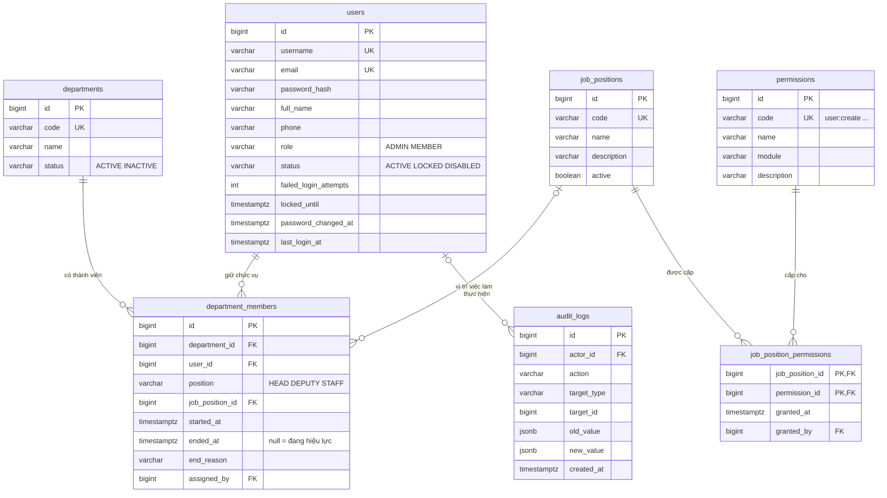

# Thiết kế CSDL: Người dùng, RBAC và tổ chức

Phạm vi: module 1 (Tài khoản & phân quyền) và module 2 (Tổ chức). Bảng của task, ủy quyền, KPI… bổ sung vào file này khi làm các module đó.

CSDL: PostgreSQL. Schema chỉ tạo/sửa qua Flyway (`src/main/resources/db/migration`). Bản trình bày trực quan: [`erd-rbac.html`](erd-rbac.html).

| Migration | Nội dung |
|---|---|
| `V1__account_and_organization.sql` | Tạo 7 bảng, ràng buộc, index (mục 6) |
| `V2__seed_permissions_and_job_positions.sql` | Seed 14 permission, 2 vị trí việc làm mẫu và cấu hình permission (mục 5.3) |

## 1. Hai lớp phân quyền

Hệ thống có **hai lớp quyền độc lập**, không trộn lẫn:

| Lớp | Quyết định điều gì | Nguồn dữ liệu | Kiểm tra ở đâu |
|---|---|---|---|
| **Quản trị** | Tạo, khóa tài khoản; CRUD phòng ban; gán chức vụ; xem toàn bộ; khóa kỳ KPI; tạo ủy quyền thay | `users.role` + permission của vị trí việc làm thuộc chức vụ đang hiệu lực (`job_position_permissions`) | Spring Security: `@PreAuthorize("hasAuthority('member:assign')")` ở controller |
| **Nghiệp vụ theo chức vụ** | Ai được giao việc cho ai, ai review, ai chấp nhận Trình TP | `department_members.position` (TP/PP/NV) + phiếu ủy quyền (module 3) | Application service + domain, qua `GetCurrentMembershipUseCase` của `organization` |

Ví dụ: một người giữ vị trí `HR_OFFICER` nhưng chức vụ là NV thì **vẫn chỉ giao được việc cho chính mình**. Permission không cho phép tham gia luồng giao việc/duyệt.

Chỉ có hai role, lưu thẳng ở cột `users.role` (không có bảng role): `ADMIN` (quản trị hệ thống) và `MEMBER` (công chức). **TP, PP, NV đều là `MEMBER`**, khác nhau ở chức vụ được gán trong `department_members`; quyền quản trị (nếu có) đến từ permission của vị trí việc làm. Không có role HR: người làm nhân sự là `MEMBER` có vị trí việc làm `HR_OFFICER`.

### Một người được quyền gì

Tính một lần lúc đăng nhập (session của Spring Security):

```text
users.role = ADMIN   →  mọi permission trong bảng permissions + ROLE_ADMIN
users.role = MEMBER  →  permission của job_position thuộc chức vụ đang hiệu lực
                        (department_members.ended_at IS NULL)
                        không có chức vụ hoặc vị trí → không có permission quản trị
```

**Cấu hình phân quyền chỉ ADMIN:** cấp/thu hồi permission cho vị trí việc làm và đổi `users.role` kiểm tra bằng `hasRole('ADMIN')`, không bằng permission, để không ai tự cấp thêm quyền cho mình.

## 2. Sơ đồ quan hệ

Cột audit `created_by`/`updated_by` đều trỏ về `users`; không vẽ để sơ đồ đỡ rối.



## 3. Bảng thuộc feature nào

Mỗi bảng có **một feature sở hữu**; chỉ feature đó đọc/ghi bảng qua JPA. Feature khác cần dữ liệu thì gọi qua port (xem `architecture.md` mục 5).

| Feature | Bảng |
|---|---|
| `account` | `users`, `permissions` |
| `organization` | `departments`, `job_positions`, `job_position_permissions`, `department_members` |
| `shared` (audit) | `audit_logs` |

Khóa ngoại xuyên feature (ví dụ `department_members.user_id → users.id`, `job_position_permissions.permission_id → permissions.id`) **vẫn tạo ở DB** để đảm bảo toàn vẹn, nhưng trong JPA entity chỉ lưu `Long userId`, không dùng `@ManyToOne` sang entity của feature khác.

## 4. Quy ước chung

- Tên bảng/cột: `snake_case`, tên bảng số nhiều.
- Khóa chính: `BIGINT GENERATED ALWAYS AS IDENTITY`.
- Thời gian: `TIMESTAMPTZ`, lưu UTC, hiển thị theo `Asia/Ho_Chi_Minh`.
- Enum: `VARCHAR` + `CHECK`, không dùng kiểu enum của PostgreSQL (dễ thêm giá trị, map thẳng `@Enumerated(EnumType.STRING)`).
- Bảng nghiệp vụ chính có cột audit: `created_at`, `created_by`, `updated_at`, `updated_by`.
- **Không xóa cứng người dùng, phòng ban.** Người dùng nghỉ việc → `status = 'DISABLED'`; phòng ban ngừng → `status = 'INACTIVE'`. Lý do: lịch sử task và KPI còn tham chiếu tới họ.
- Không có optimistic lock (không có cột `version`): hai người sửa cùng một bản ghi thì người lưu sau ghi đè.
- Tên ràng buộc: `pk_<bảng>`, `fk_<bảng>_<cột>`, `uk_<bảng>_<cột>`, `ck_<bảng>_<cột>`, index `ix_<bảng>_<cột>`.

## 5. Chi tiết bảng

### 5.1. `users` — tài khoản (account)

| Cột | Kiểu | Ghi chú |
|---|---|---|
| `id` | BIGINT PK | identity |
| `username` | VARCHAR(50) | Duy nhất theo `lower()` |
| `email` | VARCHAR(255) | Duy nhất theo `lower()`, nhận thông báo |
| `password_hash` | VARCHAR(100) | BCrypt qua `DelegatingPasswordEncoder` (tiền tố `{bcrypt}`) |
| `full_name` | VARCHAR(150) | |
| `phone` | VARCHAR(20) | Tùy chọn |
| `role` | VARCHAR(20) | `ADMIN` / `MEMBER`, mặc định `MEMBER` |
| `status` | VARCHAR(20) | `ACTIVE` / `LOCKED` (Admin khóa) / `DISABLED` (nghỉ việc) |
| `failed_login_attempts` | INT | Sai 5 lần liên tiếp → khóa tạm |
| `locked_until` | TIMESTAMPTZ | Khóa tạm 15 phút (khác `status = LOCKED`) |
| `password_changed_at` | TIMESTAMPTZ | |
| `last_login_at` | TIMESTAMPTZ | |
| audit | | `created_at`, `created_by`, `updated_at`, `updated_by` → `users` |

### 5.2. `permissions` — danh mục permission (account)

Dùng chung cho mọi người dùng. **Chỉ seed bằng Flyway, không có API thêm hoặc xóa**, vì mỗi mã gắn với một `@PreAuthorize` trong code.

| Cột | Kiểu | Ghi chú |
|---|---|---|
| `id` | BIGINT PK | |
| `code` | VARCHAR(60) UK | `<tài-nguyên>:<hành-động>`, ví dụ `user:create` |
| `name` | VARCHAR(150) | Tên hiển thị tiếng Việt |
| `module` | VARCHAR(30) | `account`, `organization`, `kpi`… |
| `description` | VARCHAR(255) | |

### 5.3. Danh mục permission và cấu hình mẫu

14 permission. Cột vị trí việc làm là dữ liệu seed mẫu; ADMIN đổi được trên giao diện. Thao tác cá nhân (hồ sơ, đổi mật khẩu, làm task) chỉ cần đăng nhập.

| Permission | Ý nghĩa | ADMIN | HR_OFFICER | SPECIALIST |
|---|---|:-:|:-:|:-:|
| `user:read` | Xem tài khoản | tất cả | ✔ | |
| `user:create` | Tạo tài khoản | tất cả | ✔ | |
| `user:update` | Sửa tài khoản | tất cả | ✔ | |
| `user:lock` | Khóa, mở khóa, vô hiệu hóa | tất cả | ✔ | |
| `user:reset-password` | Đặt lại mật khẩu người khác | tất cả | ✔ | |
| `department:read` | Xem tất cả phòng ban | tất cả | ✔ | |
| `department:manage` | Tạo, sửa, ngừng phòng ban | tất cả | | |
| `member:assign` | Gán, đổi, kết thúc chức vụ TP/PP/NV | tất cả | ✔ | |
| `job-position:manage` | Sửa tên, mô tả vị trí việc làm | tất cả | ✔ | |
| `delegation:create-on-behalf` | Tạo ủy quyền thay khi TP vắng đột xuất | tất cả | ✔ | |
| `task:read-all` | Xem toàn bộ task, không duyệt | tất cả | ✔ | |
| `kpi:read-all` | Xem KPI mọi phòng | tất cả | ✔ | |
| `kpi:lock-period` | Khóa kỳ KPI | tất cả | ✔ | |
| `audit:read` | Xem nhật ký hệ thống | tất cả | | |

### 5.4. `departments` — phòng ban (organization)

`id`, `code` (duy nhất), `name`, `description`, `status` (`ACTIVE` / `INACTIVE`), audit.

### 5.5. `job_positions` — vị trí việc làm (organization)

Vị trí việc làm (chuyên viên, chuyên viên tổ chức – nhân sự…), **khác** chức vụ TP/PP/NV.

| Cột | Kiểu | Ghi chú |
|---|---|---|
| `id` | BIGINT PK | |
| `code` | VARCHAR(30) UK | `SPECIALIST`, `HR_OFFICER`… |
| `name` | VARCHAR(150) | |
| `description` | VARCHAR(500) | |
| `active` | BOOLEAN | |
| audit | | |

### 5.6. `job_position_permissions` — permission của vị trí việc làm (organization)

| Cột | Kiểu | Ghi chú |
|---|---|---|
| `job_position_id` | BIGINT PK, FK | → `job_positions`, cascade |
| `permission_id` | BIGINT PK, FK | → `permissions`, cascade |
| `granted_at` | TIMESTAMPTZ | |
| `granted_by` | BIGINT FK | → `users` (ADMIN) |

- Khóa chính kép: một permission chỉ cấp một lần cho mỗi vị trí.
- **Chỉ ADMIN sửa** (`hasRole('ADMIN')`). `job-position:manage` chỉ cho sửa tên, mô tả, tránh người có quyền đó tự cấp thêm quyền cho vị trí của mình.
- Người dùng nhận permission của vị trí **qua chức vụ đang hiệu lực**. Hết chức vụ hoặc đổi vị trí thì mất permission cũ từ lần đăng nhập sau.

### 5.7. `department_members` — chức vụ trong phòng, có lịch sử (organization)

Mỗi dòng là **một giai đoạn** người dùng giữ một chức vụ trong một phòng; nối người dùng với vị trí việc làm.

| Cột | Kiểu | Ghi chú |
|---|---|---|
| `id` | BIGINT PK | |
| `department_id` | FK → `departments` | |
| `user_id` | FK → `users` | |
| `position` | VARCHAR(20) | `HEAD` (TP) / `DEPUTY` (PP) / `STAFF` (NV) |
| `job_position_id` | FK → `job_positions` | Quyết định permission quản trị; tùy chọn |
| `started_at` | TIMESTAMPTZ | |
| `ended_at` | TIMESTAMPTZ | `NULL` = đang hiệu lực; phải > `started_at` |
| `end_reason` | VARCHAR(255) | Chuyển phòng, nghỉ việc, đổi chức vụ… |
| `assigned_by` | FK → `users` | |
| `created_at` | TIMESTAMPTZ | |

**Đổi chức vụ / chuyển phòng = đóng dòng cũ (`ended_at`, `end_reason`) + thêm dòng mới**, trong cùng transaction. Không UPDATE `position` trên dòng cũ. Lịch sử này dùng cho BR-11 (reviewer/assignee rời phòng) và KPI theo kỳ.

### 5.8. `audit_logs` — nhật ký quản trị (shared)

| Cột | Kiểu | Ghi chú |
|---|---|---|
| `id` | BIGINT PK | |
| `actor_id` | FK → `users` | `NULL` nếu hệ thống |
| `action` | VARCHAR(50) | `USER_CREATED`, `PERMISSION_GRANTED`, `PERMISSION_REVOKED`, `MEMBER_ASSIGNED`, `LOGIN_FAILED`… |
| `target_type`, `target_id` | VARCHAR(50), BIGINT | Đối tượng bị tác động |
| `old_value`, `new_value` | JSONB | |
| `reason` | VARCHAR(500) | |
| `ip_address` | VARCHAR(45) | |
| `created_at` | TIMESTAMPTZ | |

**Chỉ thêm, không sửa, không xóa** (ứng dụng không có API sửa/xóa). Cấp, thu hồi permission cũng được ghi. Lịch sử task (module 4) dùng bảng riêng, không dùng bảng này.

## 6. Ràng buộc nghiệp vụ trong CSDL

| Ràng buộc | Cách đảm bảo |
|---|---|
| Mỗi người chỉ một chức vụ đang hiệu lực | `UNIQUE (user_id) WHERE ended_at IS NULL` (`uk_department_members_active_user`) |
| Mỗi phòng chỉ một TP đang hiệu lực | `UNIQUE (department_id) WHERE position = 'HEAD' AND ended_at IS NULL` (`uk_department_members_active_head`) |
| Một permission chỉ cấp một lần cho mỗi vị trí | `PRIMARY KEY (job_position_id, permission_id)` |
| Username, email duy nhất không phân biệt hoa thường | `UNIQUE INDEX ON users (lower(username))`, `(lower(email))` |
| Giai đoạn chức vụ hợp lệ | `CHECK (ended_at IS NULL OR ended_at > started_at)` |
| Enum hợp lệ | `CHECK` trên `users.role`, `users.status`, `departments.status`, `department_members.position` |

DDL đầy đủ: `src/main/resources/db/migration/V1__account_and_organization.sql`.

## 7. Dữ liệu khởi tạo

- `V2__seed_permissions_and_job_positions.sql`: 14 permission, vị trí `SPECIALIST` và `HR_OFFICER`, cấu hình permission của `HR_OFFICER` theo mục 5.3.
- **Tài khoản Admin đầu tiên không tạo bằng SQL** (tránh để mật khẩu/hash trong migration). Tạo bằng `ApplicationRunner` khi khởi động: nếu chưa có user `role = 'ADMIN'` → tạo từ biến môi trường `ADMIN_USERNAME`, `ADMIN_EMAIL`, `ADMIN_PASSWORD`.
- Thêm permission mới = thêm migration mới (`INSERT INTO permissions …`) cùng `@PreAuthorize` tương ứng.

## 8. Dùng trong code

- Đăng nhập bằng **session** của Spring Security (không dùng JWT/refresh token).
- Khi đăng nhập, `UserDetailsService` (adapter của `account`) nạp user và tính authorities theo mục 1 "Một người được quyền gì". Permission của vị trí việc làm lấy qua port của `organization`.
- Authorities được tính lúc đăng nhập; đổi `role`, đổi permission của vị trí hoặc đổi chức vụ có hiệu lực từ lần đăng nhập sau (hoặc hủy session của người đó ngay khi đổi).
- Controller kiểm tra bằng **permission**: `@PreAuthorize("hasAuthority('member:assign')")`. Riêng cấu hình phân quyền dùng `hasRole('ADMIN')`.
- Đăng nhập chỉ được khi `status = 'ACTIVE'` và (`locked_until` null hoặc đã qua). Sai mật khẩu 5 lần → `locked_until = now() + 15 phút`.
- Quyền theo chức vụ: feature `organization` cung cấp use case `GetCurrentMembershipUseCase` trả `(departmentId, position, jobPositionId)` đang hiệu lực của user; `task` và `delegation` dùng nó để kiểm tra ma trận giao việc, không đọc thẳng bảng `department_members`.
