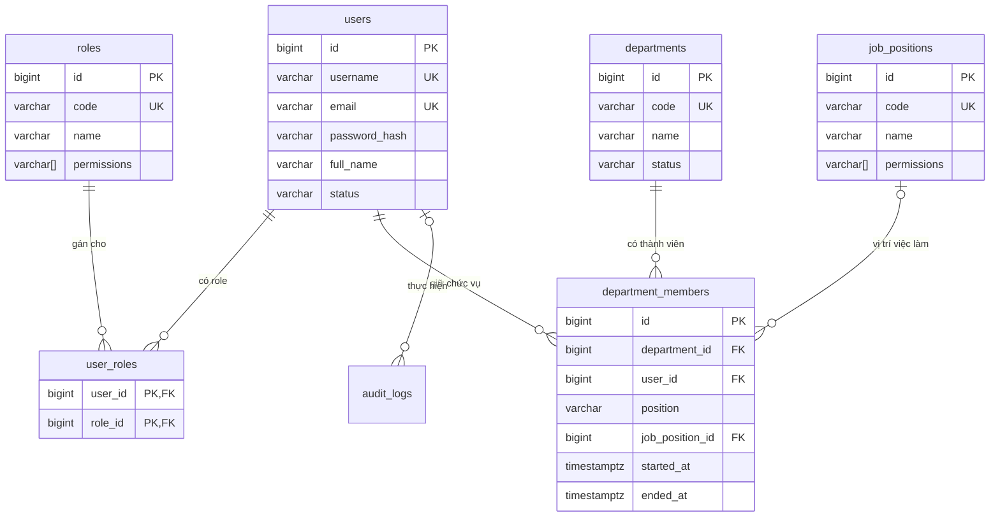

# Thiết kế CSDL: Người dùng, RBAC và tổ chức

Phạm vi: module 1 (Tài khoản & phân quyền) và module 2 (Tổ chức). Bảng của task, ủy quyền, KPI… bổ sung vào file này khi làm các module đó.

CSDL: PostgreSQL. Schema chỉ tạo/sửa qua Flyway (`src/main/resources/db/migration`).

## 1. Hai lớp phân quyền

Hệ thống có **hai lớp quyền độc lập**, không trộn lẫn:

| Lớp | Quyết định điều gì | Nguồn dữ liệu | Kiểm tra ở đâu |
|---|---|---|---|
| **RBAC hệ thống** | Quyền quản trị: tạo tài khoản, khóa tài khoản, CRUD phòng ban, gán chức vụ, xem toàn bộ, khóa kỳ KPI, tạo ủy quyền thay | `roles.permissions` (qua `user_roles`) + `job_positions.permissions` (qua chức vụ đang hiệu lực) | Spring Security: `@PreAuthorize("hasAuthority('user:create')")` ở controller |
| **Quyền nghiệp vụ theo chức vụ** | Ai được giao việc cho ai, ai review, ai chấp nhận Trình TP | `department_members.position` (TP/PP/NV) + phiếu ủy quyền (module 3) | Application service + domain, qua port của feature `organization` / `delegation` |

Ví dụ: một người có role `HR` nhưng chức vụ là NV thì **vẫn chỉ giao được việc cho chính mình**. Permission (dù đến từ role hay vị trí việc làm) không cho phép tham gia luồng giao việc/duyệt.

## 2. Sơ đồ quan hệ



## 3. Bảng thuộc feature nào

Mỗi bảng có **một feature sở hữu**; chỉ feature đó đọc/ghi bảng qua JPA. Feature khác cần dữ liệu thì gọi qua port (xem `architecture.md` mục 5).

| Feature | Bảng |
|---|---|
| `account` | `users`, `roles`, `user_roles` |
| `organization` | `departments`, `job_positions`, `department_members` |
| `shared` (audit) | `audit_logs` |

Khóa ngoại xuyên feature (ví dụ `department_members.user_id → users.id`) **vẫn tạo ở DB** để đảm bảo toàn vẹn, nhưng trong JPA entity chỉ lưu `Long userId`, không dùng `@ManyToOne` sang entity của feature khác.

## 4. Quy ước chung

- Tên bảng/cột: `snake_case`, tên bảng số nhiều.
- Khóa chính: `BIGINT GENERATED ALWAYS AS IDENTITY`.
- Thời gian: `TIMESTAMPTZ`, lưu UTC, hiển thị theo `Asia/Ho_Chi_Minh`.
- Enum: `VARCHAR` + `CHECK`, không dùng kiểu enum của PostgreSQL (dễ thêm giá trị, map thẳng `@Enumerated(EnumType.STRING)`).
- Bảng nghiệp vụ chính có cột audit: `created_at`, `created_by`, `updated_at`, `updated_by`.
- **Không xóa cứng người dùng, phòng ban.** Người dùng nghỉ việc → `status = 'DISABLED'`; phòng ban ngừng → `status = 'INACTIVE'`. Lý do: lịch sử task và KPI còn tham chiếu tới họ.
- Tên ràng buộc: `pk_<bảng>`, `fk_<bảng>_<cột>`, `uk_<bảng>_<cột>`, `ck_<bảng>_<cột>`, index `ix_<bảng>_<cột>`.

## 5. Chi tiết bảng

### 5.1. `users` — tài khoản

| Cột | Kiểu | Ghi chú |
|---|---|---|
| `id` | BIGINT PK | |
| `username` | VARCHAR(50) | Tên đăng nhập, duy nhất (không phân biệt hoa thường) |
| `email` | VARCHAR(255) | Duy nhất (không phân biệt hoa thường), dùng gửi thông báo |
| `password_hash` | VARCHAR(100) | BCrypt qua `DelegatingPasswordEncoder` (có tiền tố `{bcrypt}`) |
| `full_name` | VARCHAR(150) | |
| `phone` | VARCHAR(20) | Tùy chọn |
| `status` | VARCHAR(20) | `ACTIVE` / `LOCKED` (Admin khóa) / `DISABLED` (nghỉ việc) |
| `failed_login_attempts` | INT | Đếm số lần sai mật khẩu liên tiếp |
| `locked_until` | TIMESTAMPTZ | Khóa tạm do sai mật khẩu nhiều lần (khác `status = LOCKED`) |
| `password_changed_at` | TIMESTAMPTZ | |
| `last_login_at` | TIMESTAMPTZ | |
| audit | | `created_at`, `created_by`, `updated_at`, `updated_by` |

### 5.2. Permission — danh mục cố định trong code

Permission **không có bảng riêng**. Danh mục là enum Java `Permission` trong `account/domain`; DB lưu mã permission (chuỗi) trong cột mảng `permissions` của `roles` và `job_positions`. Ứng dụng validate mã khi ghi, mã lạ bị từ chối.

`code` dạng `<tài-nguyên>:<hành-động>`:

| `code` | Module | Ý nghĩa |
|---|---|---|
| `user:read` | account | Xem danh sách, chi tiết tài khoản |
| `user:create` | account | Tạo tài khoản |
| `user:update` | account | Sửa thông tin tài khoản |
| `user:lock` | account | Khóa / mở khóa / vô hiệu hóa tài khoản |
| `user:reset-password` | account | Đặt lại mật khẩu cho người khác |
| `role:assign` | account | Gán / gỡ role hệ thống; gán permission cho vị trí việc làm |
| `department:read` | organization | Xem tất cả phòng ban |
| `department:manage` | organization | Tạo, sửa, ngừng hoạt động phòng ban |
| `member:assign` | organization | Gán / đổi / kết thúc chức vụ TP/PP/NV |
| `job-position:manage` | organization | Quản lý danh mục vị trí việc làm (tên, mô tả) |
| `delegation:create-on-behalf` | delegation | Tạo ủy quyền thay khi TP vắng đột xuất |
| `task:read-all` | task | Xem toàn bộ task (không tham gia duyệt) |
| `kpi:read-all` | kpi | Xem KPI mọi phòng |
| `kpi:lock-period` | kpi | Khóa kỳ KPI |
| `audit:read` | shared | Xem nhật ký hệ thống |

Thao tác cá nhân (xem/sửa hồ sơ của mình, đổi mật khẩu, làm việc với task) **không cần permission**, chỉ cần đăng nhập.

### 5.3. `roles` — role hệ thống kèm permission

Gộp role, permission và bảng nối role–permission thành **một bảng**: mỗi role có cột `permissions VARCHAR(60)[]`.

| Cột | Kiểu | Ghi chú |
|---|---|---|
| `id` | BIGINT PK | |
| `code` | VARCHAR(30) | Duy nhất: `ADMIN`, `HR`, `MEMBER` |
| `name` | VARCHAR(100) | |
| `description` | VARCHAR(255) | |
| `permissions` | VARCHAR(60)[] | Danh sách mã permission, mặc định `{}` |

3 role cố định, seed bằng migration. Một người có thể có nhiều role (ví dụ `MEMBER` + `HR`).

Ma trận seed:

| Permission | ADMIN | HR | MEMBER |
|---|:-:|:-:|:-:|
| `user:read` | ✔ | ✔ | |
| `user:create` | ✔ | ✔ | |
| `user:update` | ✔ | ✔ | |
| `user:lock` | ✔ | ✔ | |
| `user:reset-password` | ✔ | ✔ | |
| `role:assign` | ✔ | | |
| `department:read` | ✔ | ✔ | |
| `department:manage` | ✔ | | |
| `member:assign` | ✔ | ✔ | |
| `job-position:manage` | ✔ | ✔ | |
| `delegation:create-on-behalf` | ✔ | ✔ | |
| `task:read-all` | ✔ | ✔ | |
| `kpi:read-all` | ✔ | ✔ | |
| `kpi:lock-period` | | ✔ | |
| `audit:read` | ✔ | | |

`kpi:lock-period` chỉ HR theo quy trình chốt điểm ("HR khóa kỳ").

### 5.4. `user_roles` — gán role cho người dùng

`user_id`, `role_id` (khóa chính kép), `assigned_at`, `assigned_by`.

### 5.5. `departments` — phòng ban

`id`, `code` (duy nhất), `name`, `description`, `status` (`ACTIVE` / `INACTIVE`), audit.

### 5.6. `job_positions` — vị trí việc làm kèm permission

Vị trí việc làm theo quy định (chuyên viên, chuyên viên chính, chuyên viên nhân sự…), **khác** chức vụ TP/PP/NV.

| Cột | Kiểu | Ghi chú |
|---|---|---|
| `id` | BIGINT PK | |
| `code` | VARCHAR(30) | Duy nhất |
| `name` | VARCHAR(150) | |
| `description` | VARCHAR(500) | |
| `permissions` | VARCHAR(60)[] | Permission người giữ vị trí này được cộng thêm, mặc định `{}` |
| `active` | BOOLEAN | |
| audit | | |

- Người dùng nhận permission của vị trí việc làm **qua chức vụ đang hiệu lực** (`department_members.job_position_id` với `ended_at IS NULL`). Hết chức vụ thì mất permission đó.
- **Chống leo thang quyền:** sửa tên/mô tả vị trí cần `job-position:manage`, nhưng sửa cột `permissions` cần `role:assign` (chỉ ADMIN). Nếu không, HR có thể tự gán cho vị trí của mình các quyền HR không có.

### 5.7. `department_members` — chức vụ trong phòng (có lịch sử)

Mỗi dòng là **một giai đoạn** người dùng giữ một chức vụ trong một phòng.

| Cột | Kiểu | Ghi chú |
|---|---|---|
| `id` | BIGINT PK | |
| `department_id` | FK → `departments` | |
| `user_id` | FK → `users` | |
| `position` | VARCHAR(20) | `HEAD` (TP) / `DEPUTY` (PP) / `STAFF` (NV) |
| `job_position_id` | FK → `job_positions` | Tùy chọn |
| `started_at` | TIMESTAMPTZ | |
| `ended_at` | TIMESTAMPTZ | `NULL` = đang giữ chức vụ |
| `end_reason` | VARCHAR(255) | Chuyển phòng, nghỉ việc, đổi chức vụ… |
| `assigned_by` | FK → `users` | Admin/HR thực hiện |
| `created_at` | TIMESTAMPTZ | |

Ràng buộc nghiệp vụ được DB đảm bảo bằng **partial unique index**:
- Mỗi người chỉ một chức vụ đang hiệu lực: `UNIQUE (user_id) WHERE ended_at IS NULL`.
- Mỗi phòng chỉ một TP đang hiệu lực: `UNIQUE (department_id) WHERE position = 'HEAD' AND ended_at IS NULL`.

**Đổi chức vụ / chuyển phòng = đóng dòng cũ (`ended_at`, `end_reason`) + thêm dòng mới**, trong cùng transaction. Không UPDATE `position` trên dòng cũ. Lịch sử này dùng cho:
- BR-11: phát hiện reviewer/assignee rời phòng để chuyển task.
- KPI: biết ai thuộc phòng nào, giữ chức vụ gì trong kỳ.

### 5.8. `audit_logs` — nhật ký quản trị

Ghi các thao tác quản trị: tạo/khóa tài khoản, gán role, sửa permission của role/vị trí việc làm, gán chức vụ, reset mật khẩu, đăng nhập thất bại…

`id`, `actor_id` (FK → `users`, null nếu hệ thống), `action` (`USER_CREATED`, `ROLE_ASSIGNED`, `JOB_POSITION_PERMISSIONS_CHANGED`, `MEMBER_ASSIGNED`, `LOGIN_FAILED`…), `target_type`, `target_id`, `old_value` JSONB, `new_value` JSONB, `reason`, `ip_address`, `created_at`.

**Chỉ thêm, không sửa, không xóa** (ứng dụng không có API sửa/xóa). Lịch sử task (module 4) dùng bảng riêng `task_histories`, không dùng bảng này.

## 6. DDL tham chiếu

Dùng làm nội dung cho migration `V1__account_and_organization.sql`.

```sql
-- ===== account =====
CREATE TABLE users (
    id                     BIGINT GENERATED ALWAYS AS IDENTITY,
    username               VARCHAR(50)  NOT NULL,
    email                  VARCHAR(255) NOT NULL,
    password_hash          VARCHAR(100) NOT NULL,
    full_name              VARCHAR(150) NOT NULL,
    phone                  VARCHAR(20),
    status                 VARCHAR(20)  NOT NULL DEFAULT 'ACTIVE',
    failed_login_attempts  INT          NOT NULL DEFAULT 0,
    locked_until           TIMESTAMPTZ,
    password_changed_at    TIMESTAMPTZ,
    last_login_at          TIMESTAMPTZ,
    created_at             TIMESTAMPTZ  NOT NULL DEFAULT now(),
    created_by             BIGINT,
    updated_at             TIMESTAMPTZ  NOT NULL DEFAULT now(),
    updated_by             BIGINT,
    CONSTRAINT pk_users PRIMARY KEY (id),
    CONSTRAINT ck_users_status CHECK (status IN ('ACTIVE', 'LOCKED', 'DISABLED')),
    CONSTRAINT fk_users_created_by FOREIGN KEY (created_by) REFERENCES users (id),
    CONSTRAINT fk_users_updated_by FOREIGN KEY (updated_by) REFERENCES users (id)
);
CREATE UNIQUE INDEX uk_users_username ON users (lower(username));
CREATE UNIQUE INDEX uk_users_email    ON users (lower(email));

CREATE TABLE roles (
    id          BIGINT GENERATED ALWAYS AS IDENTITY,
    code        VARCHAR(30)   NOT NULL,
    name        VARCHAR(100)  NOT NULL,
    description VARCHAR(255),
    permissions VARCHAR(60)[] NOT NULL DEFAULT '{}',
    CONSTRAINT pk_roles PRIMARY KEY (id),
    CONSTRAINT uk_roles_code UNIQUE (code)
);

CREATE TABLE user_roles (
    user_id     BIGINT      NOT NULL,
    role_id     BIGINT      NOT NULL,
    assigned_at TIMESTAMPTZ NOT NULL DEFAULT now(),
    assigned_by BIGINT,
    CONSTRAINT pk_user_roles PRIMARY KEY (user_id, role_id),
    CONSTRAINT fk_user_roles_user        FOREIGN KEY (user_id)     REFERENCES users (id),
    CONSTRAINT fk_user_roles_role        FOREIGN KEY (role_id)     REFERENCES roles (id),
    CONSTRAINT fk_user_roles_assigned_by FOREIGN KEY (assigned_by) REFERENCES users (id)
);
CREATE INDEX ix_user_roles_role_id ON user_roles (role_id);

-- ===== organization =====
CREATE TABLE departments (
    id          BIGINT GENERATED ALWAYS AS IDENTITY,
    code        VARCHAR(30)  NOT NULL,
    name        VARCHAR(150) NOT NULL,
    description VARCHAR(500),
    status      VARCHAR(20)  NOT NULL DEFAULT 'ACTIVE',
    created_at  TIMESTAMPTZ  NOT NULL DEFAULT now(),
    created_by  BIGINT,
    updated_at  TIMESTAMPTZ  NOT NULL DEFAULT now(),
    updated_by  BIGINT,
    CONSTRAINT pk_departments PRIMARY KEY (id),
    CONSTRAINT uk_departments_code UNIQUE (code),
    CONSTRAINT ck_departments_status CHECK (status IN ('ACTIVE', 'INACTIVE')),
    CONSTRAINT fk_departments_created_by FOREIGN KEY (created_by) REFERENCES users (id),
    CONSTRAINT fk_departments_updated_by FOREIGN KEY (updated_by) REFERENCES users (id)
);

CREATE TABLE job_positions (
    id          BIGINT GENERATED ALWAYS AS IDENTITY,
    code        VARCHAR(30)   NOT NULL,
    name        VARCHAR(150)  NOT NULL,
    description VARCHAR(500),
    permissions VARCHAR(60)[] NOT NULL DEFAULT '{}',
    active      BOOLEAN       NOT NULL DEFAULT TRUE,
    created_at  TIMESTAMPTZ   NOT NULL DEFAULT now(),
    created_by  BIGINT,
    updated_at  TIMESTAMPTZ   NOT NULL DEFAULT now(),
    updated_by  BIGINT,
    CONSTRAINT pk_job_positions PRIMARY KEY (id),
    CONSTRAINT uk_job_positions_code UNIQUE (code),
    CONSTRAINT fk_job_positions_created_by FOREIGN KEY (created_by) REFERENCES users (id),
    CONSTRAINT fk_job_positions_updated_by FOREIGN KEY (updated_by) REFERENCES users (id)
);

CREATE TABLE department_members (
    id              BIGINT GENERATED ALWAYS AS IDENTITY,
    department_id   BIGINT       NOT NULL,
    user_id         BIGINT       NOT NULL,
    position        VARCHAR(20)  NOT NULL,
    job_position_id BIGINT,
    started_at      TIMESTAMPTZ  NOT NULL DEFAULT now(),
    ended_at        TIMESTAMPTZ,
    end_reason      VARCHAR(255),
    assigned_by     BIGINT,
    created_at      TIMESTAMPTZ  NOT NULL DEFAULT now(),
    CONSTRAINT pk_department_members PRIMARY KEY (id),
    CONSTRAINT ck_department_members_position CHECK (position IN ('HEAD', 'DEPUTY', 'STAFF')),
    CONSTRAINT ck_department_members_period   CHECK (ended_at IS NULL OR ended_at > started_at),
    CONSTRAINT fk_department_members_department   FOREIGN KEY (department_id)   REFERENCES departments (id),
    CONSTRAINT fk_department_members_user         FOREIGN KEY (user_id)         REFERENCES users (id),
    CONSTRAINT fk_department_members_job_position FOREIGN KEY (job_position_id) REFERENCES job_positions (id),
    CONSTRAINT fk_department_members_assigned_by  FOREIGN KEY (assigned_by)     REFERENCES users (id)
);
-- Mỗi người chỉ một chức vụ đang hiệu lực
CREATE UNIQUE INDEX uk_department_members_active_user
    ON department_members (user_id) WHERE ended_at IS NULL;
-- Mỗi phòng chỉ một TP đang hiệu lực
CREATE UNIQUE INDEX uk_department_members_active_head
    ON department_members (department_id) WHERE position = 'HEAD' AND ended_at IS NULL;
CREATE INDEX ix_department_members_department_id ON department_members (department_id);

-- ===== shared =====
CREATE TABLE audit_logs (
    id          BIGINT GENERATED ALWAYS AS IDENTITY,
    actor_id    BIGINT,
    action      VARCHAR(50)  NOT NULL,
    target_type VARCHAR(50),
    target_id   BIGINT,
    old_value   JSONB,
    new_value   JSONB,
    reason      VARCHAR(500),
    ip_address  VARCHAR(45),
    created_at  TIMESTAMPTZ  NOT NULL DEFAULT now(),
    CONSTRAINT pk_audit_logs PRIMARY KEY (id),
    CONSTRAINT fk_audit_logs_actor FOREIGN KEY (actor_id) REFERENCES users (id)
);
CREATE INDEX ix_audit_logs_target     ON audit_logs (target_type, target_id);
CREATE INDEX ix_audit_logs_created_at ON audit_logs (created_at);
```

### Dữ liệu khởi tạo

- `V2__seed_roles.sql`: insert 3 role kèm mảng `permissions` theo ma trận mục 5.3, ví dụ:

  ```sql
  INSERT INTO roles (code, name, permissions) VALUES
    ('MEMBER', 'Thành viên', '{}'),
    ('HR', 'Nhân sự', '{user:read,user:create,user:update,user:lock,user:reset-password,department:read,member:assign,job-position:manage,delegation:create-on-behalf,task:read-all,kpi:read-all,kpi:lock-period}'),
    ('ADMIN', 'Quản trị hệ thống', '{user:read,user:create,user:update,user:lock,user:reset-password,role:assign,department:read,department:manage,member:assign,job-position:manage,delegation:create-on-behalf,task:read-all,kpi:read-all,audit:read}');
  ```

- **Tài khoản Admin đầu tiên không tạo bằng SQL** (tránh để mật khẩu/hash trong migration). Tạo bằng `ApplicationRunner` khi khởi động: nếu chưa có user nào role `ADMIN` → tạo từ biến môi trường `ADMIN_USERNAME`, `ADMIN_EMAIL`, `ADMIN_PASSWORD`.

## 7. Dùng trong code

- Đăng nhập bằng **session** của Spring Security (không dùng JWT/refresh token).
- Khi đăng nhập, `UserDetailsService` (adapter của `account`) nạp user và tính authorities:
  - role → `ROLE_ADMIN`, `ROLE_HR`, `ROLE_MEMBER`
  - permission = **hợp** của `roles.permissions` (mọi role của user) và `job_positions.permissions` (vị trí việc làm của chức vụ đang hiệu lực, lấy qua port của `organization`)
- Authorities được tính lúc đăng nhập; đổi role, đổi permission hoặc đổi chức vụ có hiệu lực từ lần đăng nhập sau (hoặc hủy session của người đó ngay khi đổi).
- Controller kiểm tra bằng **permission**, không bằng role: `@PreAuthorize("hasAuthority('member:assign')")`.
- Ánh xạ cột mảng trong JPA: `@JdbcTypeCode(SqlTypes.ARRAY) private List<String> permissions;`.
- Đăng nhập chỉ được khi `status = 'ACTIVE'` và (`locked_until` null hoặc đã qua). Sai mật khẩu 5 lần → `locked_until = now() + 15 phút`.
- Quyền theo chức vụ: feature `organization` cung cấp use case `GetCurrentMembershipUseCase` trả `(departmentId, position, jobPositionId)` đang hiệu lực của user; `task` và `delegation` dùng nó để kiểm tra ma trận giao việc, không đọc thẳng bảng `department_members`.
