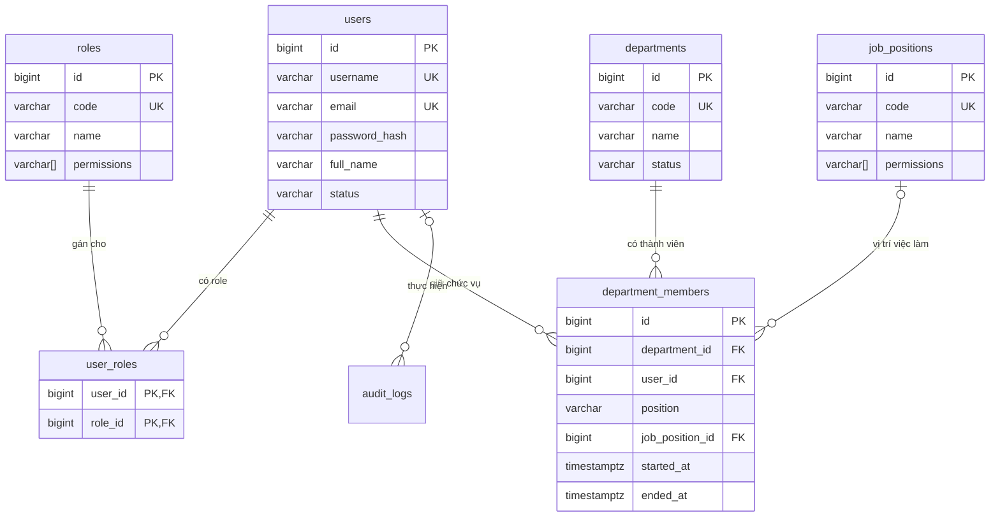
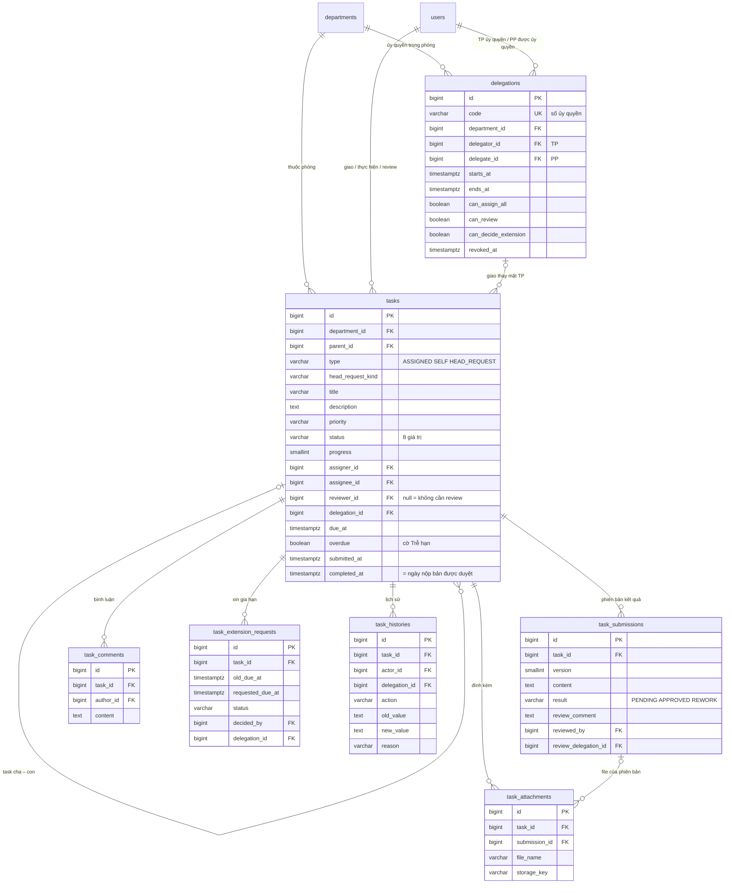
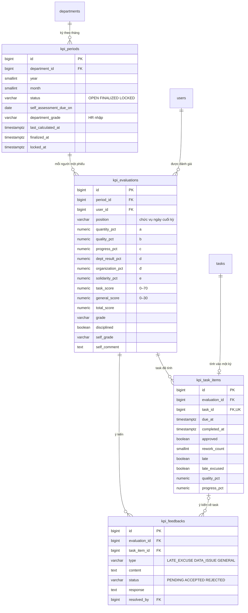

# Thiết kế CSDL

Phạm vi:
- Mục 1–7: module 1 (Tài khoản & phân quyền) và module 2 (Tổ chức).
- Mục 8: module 3–4 (Giao việc, ủy quyền, thực hiện & review).
- Mục 9: module 6 (KPI & xếp loại).

Bảng thông báo (module 5) bổ sung khi làm module đó. Sơ đồ dạng trang xem được: `erd-rbac.html` (module 1–2), `erd-task-kpi.html` (module 3, 4, 6).

CSDL: PostgreSQL. Schema chỉ tạo/sửa qua Flyway (`src/main/resources/db/migration`).

## 1. Hai lớp phân quyền

Hệ thống có **hai lớp quyền độc lập**, không trộn lẫn:

| Lớp | Quyết định điều gì | Nguồn dữ liệu | Kiểm tra ở đâu |
|---|---|---|---|
| **RBAC hệ thống** | Quyền quản trị: tạo tài khoản, khóa tài khoản, CRUD phòng ban, gán chức vụ, xem toàn bộ, khóa kỳ KPI, tạo ủy quyền thay | `roles.permissions` (qua `user_roles`) + `job_positions.permissions` (qua chức vụ đang hiệu lực) | Spring Security: `@PreAuthorize("hasAuthority('user:create')")` ở controller |
| **Quyền nghiệp vụ theo chức vụ** | Ai được giao việc cho ai, ai review, ai chấp nhận Trình TP | `department_members.position` (TP/PP/NV) + phiếu ủy quyền (module 3) | Application service + domain, qua port của feature `organization` / `delegation` |

Ví dụ: một người có role `HR` nhưng chức vụ là NV thì **vẫn chỉ giao được việc cho chính mình**. Permission (dù đến từ role hay vị trí việc làm) không cho phép tham gia luồng giao việc/duyệt.

## 2. Sơ đồ quan hệ



## 3. Bảng thuộc feature nào

Mỗi bảng có **một feature sở hữu**; chỉ feature đó đọc/ghi bảng qua JPA. Feature khác cần dữ liệu thì gọi qua port (xem `architecture.md` mục 5).

| Feature | Bảng |
|---|---|
| `account` | `users`, `roles`, `user_roles` |
| `organization` | `departments`, `job_positions`, `department_members` |
| `delegation` | `delegations` |
| `task` | `tasks`, `task_submissions`, `task_attachments`, `task_comments`, `task_extension_requests`, `task_histories` |
| `kpi` | `kpi_periods`, `kpi_evaluations`, `kpi_task_items`, `kpi_feedbacks` |
| `shared` (audit) | `audit_logs` |

Khóa ngoại xuyên feature (ví dụ `department_members.user_id → users.id`) **vẫn tạo ở DB** để đảm bảo toàn vẹn, nhưng trong JPA entity chỉ lưu `Long userId`, không dùng `@ManyToOne` sang entity của feature khác.

## 4. Quy ước chung

- Tên bảng/cột: `snake_case`, tên bảng số nhiều.
- Khóa chính: `BIGINT GENERATED ALWAYS AS IDENTITY`.
- Thời gian: `TIMESTAMPTZ`, lưu UTC, hiển thị theo `Asia/Ho_Chi_Minh`.
- Enum: `VARCHAR` + `CHECK`, không dùng kiểu enum của PostgreSQL (dễ thêm giá trị, map thẳng `@Enumerated(EnumType.STRING)`).
- Bảng nghiệp vụ chính có cột audit: `created_at`, `created_by`, `updated_at`, `updated_by`.
- **Không xóa cứng người dùng, phòng ban.** Người dùng nghỉ việc → `status = 'DISABLED'`; phòng ban ngừng → `status = 'INACTIVE'`. Lý do: lịch sử task và KPI còn tham chiếu tới họ.
- Tên ràng buộc: `pk_<bảng>`, `fk_<bảng>_<cột>`, `uk_<bảng>_<cột>`, `ck_<bảng>_<cột>`, index `ix_<bảng>_<cột>`.

## 5. Chi tiết bảng

### 5.1. `users` — tài khoản

| Cột | Kiểu | Ghi chú |
|---|---|---|
| `id` | BIGINT PK | |
| `username` | VARCHAR(50) | Tên đăng nhập, duy nhất (không phân biệt hoa thường) |
| `email` | VARCHAR(255) | Duy nhất (không phân biệt hoa thường), dùng gửi thông báo |
| `password_hash` | VARCHAR(100) | BCrypt qua `DelegatingPasswordEncoder` (có tiền tố `{bcrypt}`) |
| `full_name` | VARCHAR(150) | |
| `phone` | VARCHAR(20) | Tùy chọn |
| `status` | VARCHAR(20) | `ACTIVE` / `LOCKED` (Admin khóa) / `DISABLED` (nghỉ việc) |
| `failed_login_attempts` | INT | Đếm số lần sai mật khẩu liên tiếp |
| `locked_until` | TIMESTAMPTZ | Khóa tạm do sai mật khẩu nhiều lần (khác `status = LOCKED`) |
| `password_changed_at` | TIMESTAMPTZ | |
| `last_login_at` | TIMESTAMPTZ | |
| audit | | `created_at`, `created_by`, `updated_at`, `updated_by` |

### 5.2. Permission — danh mục cố định trong code

Permission **không có bảng riêng**. Danh mục là enum Java `Permission` trong `account/domain`; DB lưu mã permission (chuỗi) trong cột mảng `permissions` của `roles` và `job_positions`. Ứng dụng validate mã khi ghi, mã lạ bị từ chối.

`code` dạng `<tài-nguyên>:<hành-động>`:

| `code` | Module | Ý nghĩa |
|---|---|---|
| `user:read` | account | Xem danh sách, chi tiết tài khoản |
| `user:create` | account | Tạo tài khoản |
| `user:update` | account | Sửa thông tin tài khoản |
| `user:lock` | account | Khóa / mở khóa / vô hiệu hóa tài khoản |
| `user:reset-password` | account | Đặt lại mật khẩu cho người khác |
| `role:assign` | account | Gán / gỡ role hệ thống; gán permission cho vị trí việc làm |
| `department:read` | organization | Xem tất cả phòng ban |
| `department:manage` | organization | Tạo, sửa, ngừng hoạt động phòng ban |
| `member:assign` | organization | Gán / đổi / kết thúc chức vụ TP/PP/NV |
| `job-position:manage` | organization | Quản lý danh mục vị trí việc làm (tên, mô tả) |
| `delegation:create-on-behalf` | delegation | Tạo ủy quyền thay khi TP vắng đột xuất |
| `task:read-all` | task | Xem toàn bộ task (không tham gia duyệt) |
| `kpi:read-all` | kpi | Xem KPI mọi phòng |
| `kpi:lock-period` | kpi | Khóa kỳ KPI |
| `audit:read` | shared | Xem nhật ký hệ thống |

Thao tác cá nhân (xem/sửa hồ sơ của mình, đổi mật khẩu, làm việc với task) **không cần permission**, chỉ cần đăng nhập.

### 5.3. `roles` — role hệ thống kèm permission

Gộp role, permission và bảng nối role–permission thành **một bảng**: mỗi role có cột `permissions VARCHAR(60)[]`.

| Cột | Kiểu | Ghi chú |
|---|---|---|
| `id` | BIGINT PK | |
| `code` | VARCHAR(30) | Duy nhất: `ADMIN`, `HR`, `MEMBER` |
| `name` | VARCHAR(100) | |
| `description` | VARCHAR(255) | |
| `permissions` | VARCHAR(60)[] | Danh sách mã permission, mặc định `{}` |

3 role cố định, seed bằng migration. Một người có thể có nhiều role (ví dụ `MEMBER` + `HR`).

Ma trận seed:

| Permission | ADMIN | HR | MEMBER |
|---|:-:|:-:|:-:|
| `user:read` | ✔ | ✔ | |
| `user:create` | ✔ | ✔ | |
| `user:update` | ✔ | ✔ | |
| `user:lock` | ✔ | ✔ | |
| `user:reset-password` | ✔ | ✔ | |
| `role:assign` | ✔ | | |
| `department:read` | ✔ | ✔ | |
| `department:manage` | ✔ | | |
| `member:assign` | ✔ | ✔ | |
| `job-position:manage` | ✔ | ✔ | |
| `delegation:create-on-behalf` | ✔ | ✔ | |
| `task:read-all` | ✔ | ✔ | |
| `kpi:read-all` | ✔ | ✔ | |
| `kpi:lock-period` | | ✔ | |
| `audit:read` | ✔ | | |

`kpi:lock-period` chỉ HR theo quy trình chốt điểm ("HR khóa kỳ").

### 5.4. `user_roles` — gán role cho người dùng

`user_id`, `role_id` (khóa chính kép), `assigned_at`, `assigned_by`.

### 5.5. `departments` — phòng ban

`id`, `code` (duy nhất), `name`, `description`, `status` (`ACTIVE` / `INACTIVE`), audit.

### 5.6. `job_positions` — vị trí việc làm kèm permission

Vị trí việc làm theo quy định (chuyên viên, chuyên viên chính, chuyên viên nhân sự…), **khác** chức vụ TP/PP/NV.

| Cột | Kiểu | Ghi chú |
|---|---|---|
| `id` | BIGINT PK | |
| `code` | VARCHAR(30) | Duy nhất |
| `name` | VARCHAR(150) | |
| `description` | VARCHAR(500) | |
| `permissions` | VARCHAR(60)[] | Permission người giữ vị trí này được cộng thêm, mặc định `{}` |
| `active` | BOOLEAN | |
| audit | | |

- Người dùng nhận permission của vị trí việc làm **qua chức vụ đang hiệu lực** (`department_members.job_position_id` với `ended_at IS NULL`). Hết chức vụ thì mất permission đó.
- **Chống leo thang quyền:** sửa tên/mô tả vị trí cần `job-position:manage`, nhưng sửa cột `permissions` cần `role:assign` (chỉ ADMIN). Nếu không, HR có thể tự gán cho vị trí của mình các quyền HR không có.

### 5.7. `department_members` — chức vụ trong phòng (có lịch sử)

Mỗi dòng là **một giai đoạn** người dùng giữ một chức vụ trong một phòng.

| Cột | Kiểu | Ghi chú |
|---|---|---|
| `id` | BIGINT PK | |
| `department_id` | FK → `departments` | |
| `user_id` | FK → `users` | |
| `position` | VARCHAR(20) | `HEAD` (TP) / `DEPUTY` (PP) / `STAFF` (NV) |
| `job_position_id` | FK → `job_positions` | Tùy chọn |
| `started_at` | TIMESTAMPTZ | |
| `ended_at` | TIMESTAMPTZ | `NULL` = đang giữ chức vụ |
| `end_reason` | VARCHAR(255) | Chuyển phòng, nghỉ việc, đổi chức vụ… |
| `assigned_by` | FK → `users` | Admin/HR thực hiện |
| `created_at` | TIMESTAMPTZ | |

Ràng buộc nghiệp vụ được DB đảm bảo bằng **partial unique index**:
- Mỗi người chỉ một chức vụ đang hiệu lực: `UNIQUE (user_id) WHERE ended_at IS NULL`.
- Mỗi phòng chỉ một TP đang hiệu lực: `UNIQUE (department_id) WHERE position = 'HEAD' AND ended_at IS NULL`.

**Đổi chức vụ / chuyển phòng = đóng dòng cũ (`ended_at`, `end_reason`) + thêm dòng mới**, trong cùng transaction. Không UPDATE `position` trên dòng cũ. Lịch sử này dùng cho:
- BR-11: phát hiện reviewer/assignee rời phòng để chuyển task.
- KPI: biết ai thuộc phòng nào, giữ chức vụ gì trong kỳ.

### 5.8. `audit_logs` — nhật ký quản trị

Ghi các thao tác quản trị: tạo/khóa tài khoản, gán role, sửa permission của role/vị trí việc làm, gán chức vụ, reset mật khẩu, đăng nhập thất bại…

`id`, `actor_id` (FK → `users`, null nếu hệ thống), `action` (`USER_CREATED`, `ROLE_ASSIGNED`, `JOB_POSITION_PERMISSIONS_CHANGED`, `MEMBER_ASSIGNED`, `LOGIN_FAILED`…), `target_type`, `target_id`, `old_value` JSONB, `new_value` JSONB, `reason`, `ip_address`, `created_at`.

**Chỉ thêm, không sửa, không xóa** (ứng dụng không có API sửa/xóa). Lịch sử task (module 4) dùng bảng riêng `task_histories`, không dùng bảng này.

## 6. DDL tham chiếu

Dùng làm nội dung cho migration `V1__account_and_organization.sql`.

```sql
-- ===== account =====
CREATE TABLE users (
    id                     BIGINT GENERATED ALWAYS AS IDENTITY,
    username               VARCHAR(50)  NOT NULL,
    email                  VARCHAR(255) NOT NULL,
    password_hash          VARCHAR(100) NOT NULL,
    full_name              VARCHAR(150) NOT NULL,
    phone                  VARCHAR(20),
    status                 VARCHAR(20)  NOT NULL DEFAULT 'ACTIVE',
    failed_login_attempts  INT          NOT NULL DEFAULT 0,
    locked_until           TIMESTAMPTZ,
    password_changed_at    TIMESTAMPTZ,
    last_login_at          TIMESTAMPTZ,
    created_at             TIMESTAMPTZ  NOT NULL DEFAULT now(),
    created_by             BIGINT,
    updated_at             TIMESTAMPTZ  NOT NULL DEFAULT now(),
    updated_by             BIGINT,
    CONSTRAINT pk_users PRIMARY KEY (id),
    CONSTRAINT ck_users_status CHECK (status IN ('ACTIVE', 'LOCKED', 'DISABLED')),
    CONSTRAINT fk_users_created_by FOREIGN KEY (created_by) REFERENCES users (id),
    CONSTRAINT fk_users_updated_by FOREIGN KEY (updated_by) REFERENCES users (id)
);
CREATE UNIQUE INDEX uk_users_username ON users (lower(username));
CREATE UNIQUE INDEX uk_users_email    ON users (lower(email));

CREATE TABLE roles (
    id          BIGINT GENERATED ALWAYS AS IDENTITY,
    code        VARCHAR(30)   NOT NULL,
    name        VARCHAR(100)  NOT NULL,
    description VARCHAR(255),
    permissions VARCHAR(60)[] NOT NULL DEFAULT '{}',
    CONSTRAINT pk_roles PRIMARY KEY (id),
    CONSTRAINT uk_roles_code UNIQUE (code)
);

CREATE TABLE user_roles (
    user_id     BIGINT      NOT NULL,
    role_id     BIGINT      NOT NULL,
    assigned_at TIMESTAMPTZ NOT NULL DEFAULT now(),
    assigned_by BIGINT,
    CONSTRAINT pk_user_roles PRIMARY KEY (user_id, role_id),
    CONSTRAINT fk_user_roles_user        FOREIGN KEY (user_id)     REFERENCES users (id),
    CONSTRAINT fk_user_roles_role        FOREIGN KEY (role_id)     REFERENCES roles (id),
    CONSTRAINT fk_user_roles_assigned_by FOREIGN KEY (assigned_by) REFERENCES users (id)
);
CREATE INDEX ix_user_roles_role_id ON user_roles (role_id);

-- ===== organization =====
CREATE TABLE departments (
    id          BIGINT GENERATED ALWAYS AS IDENTITY,
    code        VARCHAR(30)  NOT NULL,
    name        VARCHAR(150) NOT NULL,
    description VARCHAR(500),
    status      VARCHAR(20)  NOT NULL DEFAULT 'ACTIVE',
    created_at  TIMESTAMPTZ  NOT NULL DEFAULT now(),
    created_by  BIGINT,
    updated_at  TIMESTAMPTZ  NOT NULL DEFAULT now(),
    updated_by  BIGINT,
    CONSTRAINT pk_departments PRIMARY KEY (id),
    CONSTRAINT uk_departments_code UNIQUE (code),
    CONSTRAINT ck_departments_status CHECK (status IN ('ACTIVE', 'INACTIVE')),
    CONSTRAINT fk_departments_created_by FOREIGN KEY (created_by) REFERENCES users (id),
    CONSTRAINT fk_departments_updated_by FOREIGN KEY (updated_by) REFERENCES users (id)
);

CREATE TABLE job_positions (
    id          BIGINT GENERATED ALWAYS AS IDENTITY,
    code        VARCHAR(30)   NOT NULL,
    name        VARCHAR(150)  NOT NULL,
    description VARCHAR(500),
    permissions VARCHAR(60)[] NOT NULL DEFAULT '{}',
    active      BOOLEAN       NOT NULL DEFAULT TRUE,
    created_at  TIMESTAMPTZ   NOT NULL DEFAULT now(),
    created_by  BIGINT,
    updated_at  TIMESTAMPTZ   NOT NULL DEFAULT now(),
    updated_by  BIGINT,
    CONSTRAINT pk_job_positions PRIMARY KEY (id),
    CONSTRAINT uk_job_positions_code UNIQUE (code),
    CONSTRAINT fk_job_positions_created_by FOREIGN KEY (created_by) REFERENCES users (id),
    CONSTRAINT fk_job_positions_updated_by FOREIGN KEY (updated_by) REFERENCES users (id)
);

CREATE TABLE department_members (
    id              BIGINT GENERATED ALWAYS AS IDENTITY,
    department_id   BIGINT       NOT NULL,
    user_id         BIGINT       NOT NULL,
    position        VARCHAR(20)  NOT NULL,
    job_position_id BIGINT,
    started_at      TIMESTAMPTZ  NOT NULL DEFAULT now(),
    ended_at        TIMESTAMPTZ,
    end_reason      VARCHAR(255),
    assigned_by     BIGINT,
    created_at      TIMESTAMPTZ  NOT NULL DEFAULT now(),
    CONSTRAINT pk_department_members PRIMARY KEY (id),
    CONSTRAINT ck_department_members_position CHECK (position IN ('HEAD', 'DEPUTY', 'STAFF')),
    CONSTRAINT ck_department_members_period   CHECK (ended_at IS NULL OR ended_at > started_at),
    CONSTRAINT fk_department_members_department   FOREIGN KEY (department_id)   REFERENCES departments (id),
    CONSTRAINT fk_department_members_user         FOREIGN KEY (user_id)         REFERENCES users (id),
    CONSTRAINT fk_department_members_job_position FOREIGN KEY (job_position_id) REFERENCES job_positions (id),
    CONSTRAINT fk_department_members_assigned_by  FOREIGN KEY (assigned_by)     REFERENCES users (id)
);
-- Mỗi người chỉ một chức vụ đang hiệu lực
CREATE UNIQUE INDEX uk_department_members_active_user
    ON department_members (user_id) WHERE ended_at IS NULL;
-- Mỗi phòng chỉ một TP đang hiệu lực
CREATE UNIQUE INDEX uk_department_members_active_head
    ON department_members (department_id) WHERE position = 'HEAD' AND ended_at IS NULL;
CREATE INDEX ix_department_members_department_id ON department_members (department_id);

-- ===== shared =====
CREATE TABLE audit_logs (
    id          BIGINT GENERATED ALWAYS AS IDENTITY,
    actor_id    BIGINT,
    action      VARCHAR(50)  NOT NULL,
    target_type VARCHAR(50),
    target_id   BIGINT,
    old_value   JSONB,
    new_value   JSONB,
    reason      VARCHAR(500),
    ip_address  VARCHAR(45),
    created_at  TIMESTAMPTZ  NOT NULL DEFAULT now(),
    CONSTRAINT pk_audit_logs PRIMARY KEY (id),
    CONSTRAINT fk_audit_logs_actor FOREIGN KEY (actor_id) REFERENCES users (id)
);
CREATE INDEX ix_audit_logs_target     ON audit_logs (target_type, target_id);
CREATE INDEX ix_audit_logs_created_at ON audit_logs (created_at);
```

### Dữ liệu khởi tạo

- `V2__seed_roles.sql`: insert 3 role kèm mảng `permissions` theo ma trận mục 5.3, ví dụ:

  ```sql
  INSERT INTO roles (code, name, permissions) VALUES
    ('MEMBER', 'Thành viên', '{}'),
    ('HR', 'Nhân sự', '{user:read,user:create,user:update,user:lock,user:reset-password,department:read,member:assign,job-position:manage,delegation:create-on-behalf,task:read-all,kpi:read-all,kpi:lock-period}'),
    ('ADMIN', 'Quản trị hệ thống', '{user:read,user:create,user:update,user:lock,user:reset-password,role:assign,department:read,department:manage,member:assign,job-position:manage,delegation:create-on-behalf,task:read-all,kpi:read-all,audit:read}');
  ```

- **Tài khoản Admin đầu tiên không tạo bằng SQL** (tránh để mật khẩu/hash trong migration). Tạo bằng `ApplicationRunner` khi khởi động: nếu chưa có user nào role `ADMIN` → tạo từ biến môi trường `ADMIN_USERNAME`, `ADMIN_EMAIL`, `ADMIN_PASSWORD`.

## 7. Dùng trong code

- Đăng nhập bằng **session** của Spring Security (không dùng JWT/refresh token).
- Khi đăng nhập, `UserDetailsService` (adapter của `account`) nạp user và tính authorities:
  - role → `ROLE_ADMIN`, `ROLE_HR`, `ROLE_MEMBER`
  - permission = **hợp** của `roles.permissions` (mọi role của user) và `job_positions.permissions` (vị trí việc làm của chức vụ đang hiệu lực, lấy qua port của `organization`)
- Authorities được tính lúc đăng nhập; đổi role, đổi permission hoặc đổi chức vụ có hiệu lực từ lần đăng nhập sau (hoặc hủy session của người đó ngay khi đổi).
- Controller kiểm tra bằng **permission**, không bằng role: `@PreAuthorize("hasAuthority('member:assign')")`.
- Ánh xạ cột mảng trong JPA: `@JdbcTypeCode(SqlTypes.ARRAY) private List<String> permissions;`.
- Đăng nhập chỉ được khi `status = 'ACTIVE'` và (`locked_until` null hoặc đã qua). Sai mật khẩu 5 lần → `locked_until = now() + 15 phút`.
- Quyền theo chức vụ: feature `organization` cung cấp use case `GetCurrentMembershipUseCase` trả `(departmentId, position, jobPositionId)` đang hiệu lực của user; `task` và `delegation` dùng nó để kiểm tra ma trận giao việc, không đọc thẳng bảng `department_members`.

## 8. Giao việc, ủy quyền, thực hiện & review (module 3–4)

### 8.1. Sơ đồ quan hệ

`users`, `departments` là bảng của mục 5. Cột audit (`created_by`, `updated_by`) không vẽ.



### 8.2. `tasks`

| Cột | Kiểu | Ghi chú |
|---|---|---|
| `id` | BIGINT PK | |
| `department_id` | FK → `departments` | Phòng của task (giao việc chỉ trong một phòng) |
| `parent_id` | FK → `tasks` | Task cha, null nếu là task gốc |
| `type` | VARCHAR(20) | `ASSIGNED` (được giao) / `SELF` (tự giao) / `HEAD_REQUEST` (Trình TP) |
| `head_request_kind` | VARCHAR(30) | Chỉ với Trình TP: `SIGN_DOCUMENT` / `DECISION` / `MEETING` / `BEYOND_DELEGATION` |
| `title`, `description`, `expected_output` | | `description` bắt buộc với Trình TP (nội dung cần TP làm) |
| `priority` | VARCHAR(10) | `LOW` / `NORMAL` / `HIGH` / `URGENT` |
| `status` | VARCHAR(25) | 7 trạng thái nghiệp vụ + `CANCELLED` (xem dưới) |
| `progress` | SMALLINT | 0–100 |
| `assigner_id` | FK → `users` | Người giao. Trình TP được TP giao lại thì vẫn là PP (PP theo dõi) |
| `assignee_id` | FK → `users` | Người thực hiện |
| `reviewer_id` | FK → `users` | Null khi không cần review (Trình TP, task tự giao của TP) |
| `delegation_id` | FK → `delegations` | Có giá trị khi PP tạo/giao task thay mặt TP |
| `due_at` | TIMESTAMPTZ | Hạn hiện hành (sau gia hạn). Null = không có hạn, không tính KPI |
| `original_due_at` | TIMESTAMPTZ | Hạn lúc giao |
| `overdue` | BOOLEAN | Cờ Trễ hạn (BR-12), job đặt khi quá `due_at` mà chưa nộp |
| `started_at`, `submitted_at` | TIMESTAMPTZ | `submitted_at` = lần nộp gần nhất |
| `completed_at` | TIMESTAMPTZ | Duyệt → bằng `submitted_at` của phiên bản được duyệt; Trình TP → lúc TP bấm Hoàn thành |
| `cancelled_at`, `cancelled_by`, `cancel_reason` | | BR-10 |
| audit | | |

Giá trị `status`: `PENDING_ACCEPTANCE` (Chờ chấp nhận), `REJECTED` (Bị từ chối), `ASSIGNED` (Mới giao), `IN_PROGRESS` (Đang thực hiện), `IN_REVIEW` (Chờ review), `REWORK` (Cần làm lại), `COMPLETED` (Hoàn thành), `CANCELLED` (đã hủy, BR-10). Chuyển trạng thái kiểm tra trong domain `Task`; DB chỉ kiểm tra giá trị hợp lệ.

### 8.3. `task_submissions` — phiên bản kết quả

Mỗi lần nộp là một dòng (`version` 1, 2…). `result`: `PENDING` (đang chờ review) → `APPROVED` hoặc `REWORK`. `REWORK` bắt buộc `review_comment` (BR-06). Mỗi task chỉ một phiên bản `PENDING`. `review_delegation_id` ghi khi PP duyệt thay TP. Số lần làm lại của task = số dòng `REWORK`, dùng cho chỉ số b của KPI.

### 8.4. Các bảng khác của `task`

- `task_attachments`: file đính kèm của task (`submission_id` null) hoặc của một phiên bản kết quả. File lưu ngoài DB, cột `storage_key` trỏ tới file.
- `task_comments`: bình luận, chỉ thêm.
- `task_extension_requests`: xin gia hạn. `status`: `PENDING` / `APPROVED` / `REJECTED` / `CANCELLED`; từ chối bắt buộc `decision_note`. Mỗi task chỉ một yêu cầu `PENDING`. Duyệt → cập nhật `tasks.due_at` và ghi lịch sử.
- `task_histories`: mọi thay đổi trạng thái, assignee, reviewer, hạn, tiến độ (ai, lúc nào, cũ → mới, lý do). `actor_id` null = hệ thống (job trễ hạn). `delegation_id` để hiển thị "PP A thay mặt TP B (ủy quyền số …)". **Chỉ thêm, không sửa, không xóa.**

### 8.5. `delegations` — phiếu ủy quyền

| Cột | Ghi chú |
|---|---|
| `code` | Số ủy quyền, duy nhất, ví dụ `UQ-2026-0001` |
| `department_id`, `delegator_id`, `delegate_id` | Phòng, TP ủy quyền, PP được ủy quyền |
| `starts_at`, `ends_at` | Có thể theo giờ |
| `reason` | Bắt buộc |
| `can_assign_all`, `can_review`, `can_decide_extension` | Phạm vi quyền, ít nhất một quyền |
| `revoked_at`, `revoked_by`, `revoke_reason` | TP thu hồi sớm |
| `effective_ends_at` | Cột sinh: `GREATEST(starts_at, LEAST(ends_at, revoked_at))` |
| `handover_viewed_at` | Lúc TP xem báo cáo bàn giao |
| `created_by` | TP, hoặc HR/Admin khi tạo thay (TP vắng đột xuất) |

Trạng thái **tính ra, không lưu**: `revoked_at` có giá trị → Đã thu hồi; `now() < starts_at` → Chờ hiệu lực; `now() >= ends_at` → Hết hạn; còn lại → Đang hiệu lực. Hết hạn không cần job cập nhật, nhưng vẫn cần job gửi thông báo hết hạn.

Báo cáo bàn giao không có bảng riêng: lấy `tasks` và `task_histories` có `delegation_id` của phiếu, cộng task Trình TP còn `PENDING_ACCEPTANCE`.

### 8.6. Ràng buộc trong CSDL

- Mỗi phòng chỉ một ủy quyền hiệu lực tại một thời điểm (BR-04): exclusion constraint trên `(department_id, tstzrange(starts_at, effective_ends_at))`, cần extension `btree_gist`. Thu hồi trước khi bắt đầu → khoảng rỗng, không chặn phiếu khác.
- Reviewer ≠ assignee (BR-07): `CHECK (reviewer_id IS NULL OR reviewer_id <> assignee_id)`.
- Task tự giao: `CHECK (type <> 'SELF' OR assigner_id = assignee_id)`.
- Trình TP: có `head_request_kind` và `description`.
- Đã hủy ⇔ có `cancelled_at`.
- Còn lại kiểm tra trong domain/application: ma trận giao việc, "không ủy quyền lại", PP không tự duyệt việc của mình, task Hoàn thành không hủy được, không sửa khi Chờ review (BR-09).

### 8.7. DDL tham chiếu

Dùng cho migration `V3__task_and_delegation.sql`.

```sql
CREATE EXTENSION IF NOT EXISTS btree_gist;

-- ===== delegation =====
CREATE TABLE delegations (
    id                   BIGINT GENERATED ALWAYS AS IDENTITY,
    code                 VARCHAR(30)  NOT NULL,
    department_id        BIGINT       NOT NULL,
    delegator_id         BIGINT       NOT NULL,
    delegate_id          BIGINT       NOT NULL,
    starts_at            TIMESTAMPTZ  NOT NULL,
    ends_at              TIMESTAMPTZ  NOT NULL,
    reason               VARCHAR(500) NOT NULL,
    can_assign_all       BOOLEAN      NOT NULL DEFAULT FALSE,
    can_review           BOOLEAN      NOT NULL DEFAULT FALSE,
    can_decide_extension BOOLEAN      NOT NULL DEFAULT FALSE,
    revoked_at           TIMESTAMPTZ,
    revoked_by           BIGINT,
    revoke_reason        VARCHAR(500),
    effective_ends_at    TIMESTAMPTZ GENERATED ALWAYS AS (GREATEST(starts_at, LEAST(ends_at, revoked_at))) STORED,
    handover_viewed_at   TIMESTAMPTZ,
    created_at           TIMESTAMPTZ  NOT NULL DEFAULT now(),
    created_by           BIGINT       NOT NULL,
    CONSTRAINT pk_delegations PRIMARY KEY (id),
    CONSTRAINT uk_delegations_code UNIQUE (code),
    CONSTRAINT ck_delegations_period CHECK (ends_at > starts_at),
    CONSTRAINT ck_delegations_people CHECK (delegate_id <> delegator_id),
    CONSTRAINT ck_delegations_scope  CHECK (can_assign_all OR can_review OR can_decide_extension),
    CONSTRAINT ex_delegations_overlap EXCLUDE USING gist (
        department_id WITH =, tstzrange(starts_at, effective_ends_at) WITH &&),
    CONSTRAINT fk_delegations_department FOREIGN KEY (department_id) REFERENCES departments (id),
    CONSTRAINT fk_delegations_delegator  FOREIGN KEY (delegator_id)  REFERENCES users (id),
    CONSTRAINT fk_delegations_delegate   FOREIGN KEY (delegate_id)   REFERENCES users (id),
    CONSTRAINT fk_delegations_revoked_by FOREIGN KEY (revoked_by)    REFERENCES users (id),
    CONSTRAINT fk_delegations_created_by FOREIGN KEY (created_by)    REFERENCES users (id)
);
CREATE INDEX ix_delegations_delegate_id ON delegations (delegate_id);

-- ===== task =====
CREATE TABLE tasks (
    id                BIGINT GENERATED ALWAYS AS IDENTITY,
    department_id     BIGINT       NOT NULL,
    parent_id         BIGINT,
    type              VARCHAR(20)  NOT NULL DEFAULT 'ASSIGNED',
    head_request_kind VARCHAR(30),
    title             VARCHAR(255) NOT NULL,
    description       TEXT,
    expected_output   VARCHAR(500),
    priority          VARCHAR(10)  NOT NULL DEFAULT 'NORMAL',
    status            VARCHAR(25)  NOT NULL,
    progress          SMALLINT     NOT NULL DEFAULT 0,
    assigner_id       BIGINT       NOT NULL,
    assignee_id       BIGINT       NOT NULL,
    reviewer_id       BIGINT,
    delegation_id     BIGINT,
    due_at            TIMESTAMPTZ,
    original_due_at   TIMESTAMPTZ,
    overdue           BOOLEAN      NOT NULL DEFAULT FALSE,
    started_at        TIMESTAMPTZ,
    submitted_at      TIMESTAMPTZ,
    completed_at      TIMESTAMPTZ,
    cancelled_at      TIMESTAMPTZ,
    cancelled_by      BIGINT,
    cancel_reason     VARCHAR(500),
    created_at        TIMESTAMPTZ  NOT NULL DEFAULT now(),
    created_by        BIGINT,
    updated_at        TIMESTAMPTZ  NOT NULL DEFAULT now(),
    updated_by        BIGINT,
    CONSTRAINT pk_tasks PRIMARY KEY (id),
    CONSTRAINT ck_tasks_type     CHECK (type IN ('ASSIGNED', 'SELF', 'HEAD_REQUEST')),
    CONSTRAINT ck_tasks_priority CHECK (priority IN ('LOW', 'NORMAL', 'HIGH', 'URGENT')),
    CONSTRAINT ck_tasks_status   CHECK (status IN ('PENDING_ACCEPTANCE', 'REJECTED', 'ASSIGNED', 'IN_PROGRESS',
                                                   'IN_REVIEW', 'REWORK', 'COMPLETED', 'CANCELLED')),
    CONSTRAINT ck_tasks_progress CHECK (progress BETWEEN 0 AND 100),
    CONSTRAINT ck_tasks_reviewer CHECK (reviewer_id IS NULL OR reviewer_id <> assignee_id),
    CONSTRAINT ck_tasks_self     CHECK (type <> 'SELF' OR assigner_id = assignee_id),
    CONSTRAINT ck_tasks_head_request CHECK (
        (type = 'HEAD_REQUEST') = (head_request_kind IS NOT NULL)
        AND (type <> 'HEAD_REQUEST' OR description IS NOT NULL)),
    CONSTRAINT ck_tasks_head_request_kind CHECK (head_request_kind IN ('SIGN_DOCUMENT', 'DECISION', 'MEETING', 'BEYOND_DELEGATION')),
    CONSTRAINT ck_tasks_cancelled CHECK ((status = 'CANCELLED') = (cancelled_at IS NOT NULL)),
    CONSTRAINT ck_tasks_parent    CHECK (parent_id <> id),
    CONSTRAINT fk_tasks_department   FOREIGN KEY (department_id) REFERENCES departments (id),
    CONSTRAINT fk_tasks_parent       FOREIGN KEY (parent_id)     REFERENCES tasks (id),
    CONSTRAINT fk_tasks_assigner     FOREIGN KEY (assigner_id)   REFERENCES users (id),
    CONSTRAINT fk_tasks_assignee     FOREIGN KEY (assignee_id)   REFERENCES users (id),
    CONSTRAINT fk_tasks_reviewer     FOREIGN KEY (reviewer_id)   REFERENCES users (id),
    CONSTRAINT fk_tasks_delegation   FOREIGN KEY (delegation_id) REFERENCES delegations (id),
    CONSTRAINT fk_tasks_cancelled_by FOREIGN KEY (cancelled_by)  REFERENCES users (id),
    CONSTRAINT fk_tasks_created_by   FOREIGN KEY (created_by)    REFERENCES users (id),
    CONSTRAINT fk_tasks_updated_by   FOREIGN KEY (updated_by)    REFERENCES users (id)
);
CREATE INDEX ix_tasks_assignee_status ON tasks (assignee_id, status);
CREATE INDEX ix_tasks_assigner_id     ON tasks (assigner_id);
CREATE INDEX ix_tasks_reviewer_review ON tasks (reviewer_id) WHERE status = 'IN_REVIEW';
CREATE INDEX ix_tasks_department_due  ON tasks (department_id, due_at);
CREATE INDEX ix_tasks_parent_id       ON tasks (parent_id);

CREATE TABLE task_submissions (
    id                   BIGINT GENERATED ALWAYS AS IDENTITY,
    task_id              BIGINT       NOT NULL,
    version              SMALLINT     NOT NULL,
    content              TEXT         NOT NULL,
    link_url             VARCHAR(1000),
    submitted_by         BIGINT       NOT NULL,
    submitted_at         TIMESTAMPTZ  NOT NULL DEFAULT now(),
    result               VARCHAR(10)  NOT NULL DEFAULT 'PENDING',
    review_comment       TEXT,
    reviewed_by          BIGINT,
    reviewed_at          TIMESTAMPTZ,
    review_delegation_id BIGINT,
    CONSTRAINT pk_task_submissions PRIMARY KEY (id),
    CONSTRAINT uk_task_submissions_version UNIQUE (task_id, version),
    CONSTRAINT ck_task_submissions_result  CHECK (result IN ('PENDING', 'APPROVED', 'REWORK')),
    CONSTRAINT ck_task_submissions_review  CHECK ((result = 'PENDING') = (reviewed_at IS NULL)),
    CONSTRAINT ck_task_submissions_rework  CHECK (result <> 'REWORK' OR review_comment IS NOT NULL),
    CONSTRAINT fk_task_submissions_task         FOREIGN KEY (task_id)              REFERENCES tasks (id),
    CONSTRAINT fk_task_submissions_submitted_by FOREIGN KEY (submitted_by)         REFERENCES users (id),
    CONSTRAINT fk_task_submissions_reviewed_by  FOREIGN KEY (reviewed_by)          REFERENCES users (id),
    CONSTRAINT fk_task_submissions_delegation   FOREIGN KEY (review_delegation_id) REFERENCES delegations (id)
);
-- Mỗi task chỉ một phiên bản đang chờ review
CREATE UNIQUE INDEX uk_task_submissions_pending ON task_submissions (task_id) WHERE result = 'PENDING';

CREATE TABLE task_attachments (
    id            BIGINT GENERATED ALWAYS AS IDENTITY,
    task_id       BIGINT       NOT NULL,
    submission_id BIGINT,
    file_name     VARCHAR(255) NOT NULL,
    content_type  VARCHAR(100),
    size_bytes    BIGINT       NOT NULL,
    storage_key   VARCHAR(500) NOT NULL,
    uploaded_by   BIGINT       NOT NULL,
    uploaded_at   TIMESTAMPTZ  NOT NULL DEFAULT now(),
    CONSTRAINT pk_task_attachments PRIMARY KEY (id),
    CONSTRAINT fk_task_attachments_task        FOREIGN KEY (task_id)       REFERENCES tasks (id),
    CONSTRAINT fk_task_attachments_submission  FOREIGN KEY (submission_id) REFERENCES task_submissions (id),
    CONSTRAINT fk_task_attachments_uploaded_by FOREIGN KEY (uploaded_by)   REFERENCES users (id)
);
CREATE INDEX ix_task_attachments_task_id ON task_attachments (task_id);

CREATE TABLE task_comments (
    id         BIGINT GENERATED ALWAYS AS IDENTITY,
    task_id    BIGINT      NOT NULL,
    author_id  BIGINT      NOT NULL,
    content    TEXT        NOT NULL,
    created_at TIMESTAMPTZ NOT NULL DEFAULT now(),
    CONSTRAINT pk_task_comments PRIMARY KEY (id),
    CONSTRAINT fk_task_comments_task   FOREIGN KEY (task_id)   REFERENCES tasks (id),
    CONSTRAINT fk_task_comments_author FOREIGN KEY (author_id) REFERENCES users (id)
);
CREATE INDEX ix_task_comments_task_id ON task_comments (task_id);

CREATE TABLE task_extension_requests (
    id               BIGINT GENERATED ALWAYS AS IDENTITY,
    task_id          BIGINT       NOT NULL,
    requested_by     BIGINT       NOT NULL,
    old_due_at       TIMESTAMPTZ  NOT NULL,
    requested_due_at TIMESTAMPTZ  NOT NULL,
    reason           VARCHAR(500) NOT NULL,
    status           VARCHAR(10)  NOT NULL DEFAULT 'PENDING',
    decided_by       BIGINT,
    decided_at       TIMESTAMPTZ,
    decision_note    VARCHAR(500),
    delegation_id    BIGINT,
    created_at       TIMESTAMPTZ  NOT NULL DEFAULT now(),
    CONSTRAINT pk_task_extension_requests PRIMARY KEY (id),
    CONSTRAINT ck_task_extension_requests_status   CHECK (status IN ('PENDING', 'APPROVED', 'REJECTED', 'CANCELLED')),
    CONSTRAINT ck_task_extension_requests_due      CHECK (requested_due_at > old_due_at),
    CONSTRAINT ck_task_extension_requests_rejected CHECK (status <> 'REJECTED' OR decision_note IS NOT NULL),
    CONSTRAINT fk_task_extension_requests_task         FOREIGN KEY (task_id)       REFERENCES tasks (id),
    CONSTRAINT fk_task_extension_requests_requested_by FOREIGN KEY (requested_by)  REFERENCES users (id),
    CONSTRAINT fk_task_extension_requests_decided_by   FOREIGN KEY (decided_by)    REFERENCES users (id),
    CONSTRAINT fk_task_extension_requests_delegation   FOREIGN KEY (delegation_id) REFERENCES delegations (id)
);
CREATE UNIQUE INDEX uk_task_extension_requests_pending ON task_extension_requests (task_id) WHERE status = 'PENDING';

CREATE TABLE task_histories (
    id            BIGINT GENERATED ALWAYS AS IDENTITY,
    task_id       BIGINT      NOT NULL,
    actor_id      BIGINT,
    delegation_id BIGINT,
    action        VARCHAR(40) NOT NULL,
    field_name    VARCHAR(40),
    old_value     TEXT,
    new_value     TEXT,
    reason        VARCHAR(1000),
    created_at    TIMESTAMPTZ NOT NULL DEFAULT now(),
    CONSTRAINT pk_task_histories PRIMARY KEY (id),
    CONSTRAINT fk_task_histories_task       FOREIGN KEY (task_id)       REFERENCES tasks (id),
    CONSTRAINT fk_task_histories_actor      FOREIGN KEY (actor_id)      REFERENCES users (id),
    CONSTRAINT fk_task_histories_delegation FOREIGN KEY (delegation_id) REFERENCES delegations (id)
);
CREATE INDEX ix_task_histories_task_created ON task_histories (task_id, created_at);
CREATE INDEX ix_task_histories_delegation   ON task_histories (delegation_id) WHERE delegation_id IS NOT NULL;
```

Giá trị `task_histories.action` (enum Java): `CREATED`, `ACCEPTED`, `REJECTED`, `RESUBMITTED`, `REASSIGNED`, `STARTED`, `PROGRESS_UPDATED`, `SUBMITTED`, `APPROVED`, `REWORK_REQUESTED`, `COMPLETED`, `REVIEWER_CHANGED`, `DUE_CHANGED`, `OVERDUE_FLAGGED`, `CANCELLED`.

## 9. KPI (module 6)

Nghiệp vụ chi tiết: mục 10.5–10.10 của tài liệu nghiệp vụ (`Tai_lieu_nghiep_vu_He_thong_quan_ly_cong_viec.docx`), quy tắc KR-01…KR-11.

### 9.1. Sơ đồ quan hệ



### 9.2. `kpi_periods` — kỳ đánh giá của một phòng trong một tháng

Job ngày 1 hằng tháng tạo kỳ của tháng trước cho mọi phòng `ACTIVE` và tính điểm nháp. `status`:

| Giá trị | Ý nghĩa | Chuyển tiếp |
|---|---|---|
| `OPEN` | Đang đánh giá: tự đánh giá, ý kiến, chấm tay; điểm tự tính lại | TP chốt → `FINALIZED` |
| `FINALIZED` | Đã chốt, không tính lại | HR khóa → `LOCKED`; HR trả lại (`returned_reason`) → `OPEN` |
| `LOCKED` | Đã khóa, trạng thái cuối | — |

Cột khác: `self_assessment_due_on` (mặc định ngày 5), `department_grade` + `department_grade_by` (HR nhập xếp loại phòng), `last_calculated_at`, `finalized_at/by`, `returned_reason`, `locked_at/by`. Duy nhất `(department_id, year, month)`.

### 9.3. `kpi_evaluations` — phiếu đánh giá của một người trong kỳ

- `position`: chức vụ ngày cuối kỳ. `STAFF` dùng 3 chỉ số; `HEAD`, `DEPUTY` dùng 6 chỉ số (d, đ, e chỉ có giá trị với lãnh đạo).
- `task_count`, `approved_count`, `quantity_pct` (a), `quality_pct` (b), `progress_pct` (c): hệ thống tính. `dept_result_pct` (d): hệ thống tính sau khi mọi NV có xếp loại.
- `organization_pct` (đ), `solidarity_pct` (e), `general_score` (0–30), `general_comment`, `scored_by`, `scored_at`: chấm tay (TP chấm NV, PP; HR nhập cho TP).
- `task_score` (0–70): tính từ các chỉ số. `task_score_manual = TRUE` khi không có task trong kỳ, TP nhập tay, bắt buộc `task_score_note`.
- `total_score` = `task_score` + `general_score`; `grade`: `EXCELLENT` / `GOOD` / `COMPLETED` / `NOT_COMPLETED`, sau khi áp ràng buộc kỷ luật và "TP không cao hơn phòng"; `grade_note` ghi lý do khi bị hạ.
- `disciplined`, `discipline_note`: HR đánh dấu, kèm số quyết định.
- `self_grade`, `self_comment`, `self_assessed_at`: tự đánh giá.
- Duy nhất `(period_id, user_id)`.

### 9.4. `kpi_task_items` — task đã tính vào điểm

Ảnh chụp dữ liệu task lúc tính, để người được đánh giá xem chi tiết và để điểm không đổi khi task bị sửa sau khi khóa kỳ (KR-11). Mỗi lần tính lại (kỳ `OPEN`), cập nhật các dòng của phiếu: thêm task mới thuộc kỳ, sửa số liệu, xóa task không còn thuộc kỳ (ý kiến gắn task bị xóa giữ lại, `task_item_id` thành null). `UNIQUE (task_id)`: một task chỉ tính vào một kỳ; khi chọn task cho kỳ mới, bỏ qua task đã có trong kỳ đã chốt hoặc khóa.

### 9.5. `kpi_feedbacks` — ý kiến khi tự đánh giá

`type`: `LATE_EXCUSE` (xin xác nhận trễ có lý do), `DATA_ISSUE` (khiếu nại số liệu) – cả hai gắn với một `task_item_id`; `GENERAL` (ý kiến chung). Từ chối bắt buộc `response`. File đính kèm (nếu có) lưu ở `attachment_name`, `attachment_key`. Khi tính lại, `kpi_task_items.late_excused` = có ý kiến `LATE_EXCUSE` được chấp nhận cho task đó.

### 9.6. Điểm năm

Không có bảng: tính bằng truy vấn trung bình `total_score` của các phiếu thuộc kỳ `LOCKED` trong năm. Cần lưu thì thêm bảng sau.

### 9.7. DDL tham chiếu

Dùng cho migration `V4__kpi.sql`.

```sql
CREATE TABLE kpi_periods (
    id                     BIGINT GENERATED ALWAYS AS IDENTITY,
    department_id          BIGINT      NOT NULL,
    year                   SMALLINT    NOT NULL,
    month                  SMALLINT    NOT NULL,
    status                 VARCHAR(15) NOT NULL DEFAULT 'OPEN',
    self_assessment_due_on DATE        NOT NULL,
    department_grade       VARCHAR(20),
    department_grade_by    BIGINT,
    last_calculated_at     TIMESTAMPTZ,
    finalized_at           TIMESTAMPTZ,
    finalized_by           BIGINT,
    returned_reason        VARCHAR(500),
    locked_at              TIMESTAMPTZ,
    locked_by              BIGINT,
    created_at             TIMESTAMPTZ NOT NULL DEFAULT now(),
    CONSTRAINT pk_kpi_periods PRIMARY KEY (id),
    CONSTRAINT uk_kpi_periods_department_month UNIQUE (department_id, year, month),
    CONSTRAINT ck_kpi_periods_month  CHECK (month BETWEEN 1 AND 12),
    CONSTRAINT ck_kpi_periods_status CHECK (status IN ('OPEN', 'FINALIZED', 'LOCKED')),
    CONSTRAINT ck_kpi_periods_department_grade CHECK (department_grade IN ('EXCELLENT', 'GOOD', 'COMPLETED', 'NOT_COMPLETED')),
    CONSTRAINT ck_kpi_periods_finalized CHECK (status = 'OPEN' OR finalized_at IS NOT NULL),
    CONSTRAINT ck_kpi_periods_locked    CHECK ((status = 'LOCKED') = (locked_at IS NOT NULL)),
    CONSTRAINT fk_kpi_periods_department          FOREIGN KEY (department_id)       REFERENCES departments (id),
    CONSTRAINT fk_kpi_periods_department_grade_by FOREIGN KEY (department_grade_by) REFERENCES users (id),
    CONSTRAINT fk_kpi_periods_finalized_by        FOREIGN KEY (finalized_by)        REFERENCES users (id),
    CONSTRAINT fk_kpi_periods_locked_by           FOREIGN KEY (locked_by)           REFERENCES users (id)
);

CREATE TABLE kpi_evaluations (
    id                BIGINT GENERATED ALWAYS AS IDENTITY,
    period_id         BIGINT       NOT NULL,
    user_id           BIGINT       NOT NULL,
    position          VARCHAR(20)  NOT NULL,
    task_count        INT          NOT NULL DEFAULT 0,
    approved_count    INT          NOT NULL DEFAULT 0,
    quantity_pct      NUMERIC(5,2),
    quality_pct       NUMERIC(5,2),
    progress_pct      NUMERIC(5,2),
    dept_result_pct   NUMERIC(5,2),
    organization_pct  NUMERIC(5,2),
    solidarity_pct    NUMERIC(5,2),
    task_score        NUMERIC(4,1),
    task_score_manual BOOLEAN      NOT NULL DEFAULT FALSE,
    task_score_note   VARCHAR(500),
    general_score     NUMERIC(4,1),
    general_comment   VARCHAR(1000),
    scored_by         BIGINT,
    scored_at         TIMESTAMPTZ,
    total_score       NUMERIC(4,1),
    grade             VARCHAR(20),
    grade_note        VARCHAR(500),
    disciplined       BOOLEAN      NOT NULL DEFAULT FALSE,
    discipline_note   VARCHAR(255),
    self_grade        VARCHAR(20),
    self_comment      TEXT,
    self_assessed_at  TIMESTAMPTZ,
    updated_at        TIMESTAMPTZ  NOT NULL DEFAULT now(),
    CONSTRAINT pk_kpi_evaluations PRIMARY KEY (id),
    CONSTRAINT uk_kpi_evaluations_period_user UNIQUE (period_id, user_id),
    CONSTRAINT ck_kpi_evaluations_position CHECK (position IN ('HEAD', 'DEPUTY', 'STAFF')),
    CONSTRAINT ck_kpi_evaluations_pct CHECK (
        quantity_pct     BETWEEN 0 AND 100 AND quality_pct     BETWEEN 0 AND 100 AND
        progress_pct     BETWEEN 0 AND 100 AND dept_result_pct BETWEEN 0 AND 100 AND
        organization_pct BETWEEN 0 AND 100 AND solidarity_pct  BETWEEN 0 AND 100),
    CONSTRAINT ck_kpi_evaluations_leader_only CHECK (
        position <> 'STAFF' OR (dept_result_pct IS NULL AND organization_pct IS NULL AND solidarity_pct IS NULL)),
    CONSTRAINT ck_kpi_evaluations_task_score    CHECK (task_score BETWEEN 0 AND 70),
    CONSTRAINT ck_kpi_evaluations_general_score CHECK (general_score BETWEEN 0 AND 30),
    CONSTRAINT ck_kpi_evaluations_manual CHECK (NOT task_score_manual OR task_score_note IS NOT NULL),
    CONSTRAINT ck_kpi_evaluations_grade      CHECK (grade      IN ('EXCELLENT', 'GOOD', 'COMPLETED', 'NOT_COMPLETED')),
    CONSTRAINT ck_kpi_evaluations_self_grade CHECK (self_grade IN ('EXCELLENT', 'GOOD', 'COMPLETED', 'NOT_COMPLETED')),
    CONSTRAINT fk_kpi_evaluations_period    FOREIGN KEY (period_id) REFERENCES kpi_periods (id),
    CONSTRAINT fk_kpi_evaluations_user      FOREIGN KEY (user_id)   REFERENCES users (id),
    CONSTRAINT fk_kpi_evaluations_scored_by FOREIGN KEY (scored_by) REFERENCES users (id)
);
CREATE INDEX ix_kpi_evaluations_user_id ON kpi_evaluations (user_id);

CREATE TABLE kpi_task_items (
    id            BIGINT GENERATED ALWAYS AS IDENTITY,
    evaluation_id BIGINT       NOT NULL,
    task_id       BIGINT       NOT NULL,
    due_at        TIMESTAMPTZ  NOT NULL,
    completed_at  TIMESTAMPTZ,
    approved      BOOLEAN      NOT NULL,
    rework_count  SMALLINT     NOT NULL DEFAULT 0,
    late          BOOLEAN,
    late_excused  BOOLEAN      NOT NULL DEFAULT FALSE,
    quality_pct   NUMERIC(5,2),
    progress_pct  NUMERIC(5,2),
    CONSTRAINT pk_kpi_task_items PRIMARY KEY (id),
    CONSTRAINT uk_kpi_task_items_task UNIQUE (task_id),
    CONSTRAINT ck_kpi_task_items_approved CHECK (approved = (completed_at IS NOT NULL)),
    CONSTRAINT fk_kpi_task_items_evaluation FOREIGN KEY (evaluation_id) REFERENCES kpi_evaluations (id),
    CONSTRAINT fk_kpi_task_items_task       FOREIGN KEY (task_id)       REFERENCES tasks (id)
);
CREATE INDEX ix_kpi_task_items_evaluation_id ON kpi_task_items (evaluation_id);

CREATE TABLE kpi_feedbacks (
    id              BIGINT GENERATED ALWAYS AS IDENTITY,
    evaluation_id   BIGINT       NOT NULL,
    task_item_id    BIGINT,
    type            VARCHAR(15)  NOT NULL,
    content         TEXT         NOT NULL,
    attachment_name VARCHAR(255),
    attachment_key  VARCHAR(500),
    status          VARCHAR(10)  NOT NULL DEFAULT 'PENDING',
    response        VARCHAR(1000),
    resolved_by     BIGINT,
    resolved_at     TIMESTAMPTZ,
    created_by      BIGINT       NOT NULL,
    created_at      TIMESTAMPTZ  NOT NULL DEFAULT now(),
    CONSTRAINT pk_kpi_feedbacks PRIMARY KEY (id),
    CONSTRAINT ck_kpi_feedbacks_type     CHECK (type IN ('LATE_EXCUSE', 'DATA_ISSUE', 'GENERAL')),
    CONSTRAINT ck_kpi_feedbacks_status   CHECK (status IN ('PENDING', 'ACCEPTED', 'REJECTED')),
    CONSTRAINT ck_kpi_feedbacks_rejected CHECK (status <> 'REJECTED' OR response IS NOT NULL),
    CONSTRAINT fk_kpi_feedbacks_evaluation  FOREIGN KEY (evaluation_id) REFERENCES kpi_evaluations (id),
    CONSTRAINT fk_kpi_feedbacks_task_item   FOREIGN KEY (task_item_id)  REFERENCES kpi_task_items (id) ON DELETE SET NULL,
    CONSTRAINT fk_kpi_feedbacks_resolved_by FOREIGN KEY (resolved_by)   REFERENCES users (id),
    CONSTRAINT fk_kpi_feedbacks_created_by  FOREIGN KEY (created_by)    REFERENCES users (id)
);
CREATE INDEX ix_kpi_feedbacks_evaluation_id ON kpi_feedbacks (evaluation_id);
```

`LATE_EXCUSE` và `DATA_ISSUE` bắt buộc `task_item_id` khi tạo; kiểm tra ở application (không đặt CHECK vì `task_item_id` có thể thành null khi task không còn thuộc kỳ).

### 9.8. Dùng trong code

- Feature `kpi` không đọc thẳng bảng `tasks`: gọi query use case của `task` (ví dụ `FindTasksForKpiUseCase(departmentId, from, to)`) trả về hạn, ngày hoàn thành, số lần làm lại, loại task, người thực hiện.
- Công thức a/b/c/d và xếp loại nằm trong domain `kpi` (`KpiEvaluation`), unit test bằng ví dụ ở mục 10.2 của tài liệu nghiệp vụ (kết quả 92,7 → Xuất sắc).
- Tính lại khi kỳ `OPEN`: job hằng đêm, và khi nhận sự kiện task được duyệt / ý kiến được chấp nhận.
