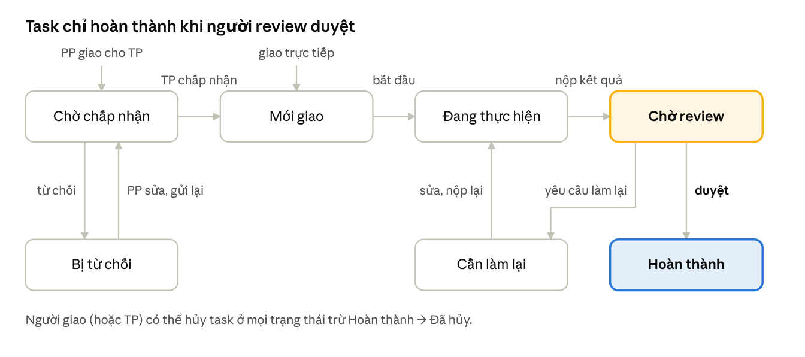

# Tài liệu nghiệp vụ – Hệ thống quản lý công việc trong cơ quan nhà nước

Oct 23, 2026 · @Mio

## 1. Mục đích & phạm vi

Tài liệu chốt cách giao việc và duyệt kết quả trong một phòng của cơ quan nhà nước: **luồng chuẩn là Trưởng phòng → Phó phòng → Nhân viên**; khi Trưởng phòng vắng thì **ủy quyền** cho Phó phòng; một số việc cần thẩm quyền Trưởng phòng thì **Phó phòng được giao ngược lên**; và mọi kết quả của nhân viên phải được **review** trước khi tính là Hoàn thành.

- Phạm vi: giao việc, nhận việc, cập nhật tiến độ, nộp kết quả, review, đóng việc trong phạm vi một phòng ban.
- Ngoài phạm vi: chấm công, lương, KPI tổng hợp (thuộc module nhân sự).
- Thuật ngữ: người giao (assigner) là người tạo và giao task; người thực hiện (assignee) là người nhận task; người review (reviewer) là người duyệt kết quả.

## 2. Vai trò & chức vụ

Quyền giao việc dựa trên **chức vụ trong phòng ban**, không dựa trên role hệ thống. Role hệ thống (Admin, HR, Member) chỉ quyết định quyền quản trị.

| Chức vụ | Số lượng / phòng | Trách nhiệm chính trong module task |
|---|---|---|
| Trưởng phòng (TP) | 1 | Nhận nhiệm vụ từ cấp trên, giao chủ yếu cho PP (có thể giao thẳng NV); ủy quyền cho PP khi vắng; review mặc định |
| Phó phòng (PP) | 0..n | Nhận việc từ TP, phân công tiếp cho NV và review; thay TP khi được ủy quyền; trình TP các việc cần thẩm quyền TP |
| Nhân viên (NV) | 0..n | Nhận việc, cập nhật tiến độ, nộp kết quả |
| Admin / HR | — | Gán chức vụ, tạo ủy quyền thay khi TP vắng đột xuất, xem toàn bộ; không tham gia luồng duyệt |

Một người chỉ có một chức vụ trong một phòng ban tại một thời điểm.

## 3. Quy tắc giao việc

Phần lớn việc đi theo **TP → PP → NV**. Có hai ngoại lệ: TP bận (đi họp, công tác, nghỉ phép) thì ủy quyền cho PP; và với một số loại việc cần thẩm quyền TP, PP được giao ngược lên TP.

### 3.1 Luồng chuẩn

1. TP nhận nhiệm vụ (từ lãnh đạo cơ quan, văn bản đến) và giao cho PP phụ trách mảng đó.
2. PP chia nhỏ thành task con, giao cho NV (hoặc tự làm). Task con gắn với task cha.
3. NV nộp kết quả → PP review. Khi mọi task con xong, PP nộp task cha → TP review.
4. TP vẫn được giao thẳng cho NV khi cần (việc gấp, việc nhỏ).

### 3.2 Ma trận giao việc (trong cùng phòng)

| Người giao ↓ / Người nhận → | Trưởng phòng | Phó phòng | Nhân viên | Chính mình |
|---|---|---|---|---|
| Trưởng phòng | — | **Giao trực tiếp (luồng chính)** | Giao trực tiếp | Được |
| Phó phòng (bình thường) | Chỉ việc loại Trình TP (mục 3.4), TP phải chấp nhận | Không | Giao trực tiếp | Được |
| Phó phòng (đang được ủy quyền) | Chỉ việc loại Trình TP, chờ TP về xử lý | Giao trực tiếp (thay TP) | Giao trực tiếp | Được |
| Nhân viên | Không | Không | Không | Được (việc cá nhân) |

"Giao trực tiếp" = task vào thẳng Mới giao, người nhận không được từ chối (chỉ xin gia hạn). Giao khác phòng: ngoài phạm vi bản này.

### 3.3 Ủy quyền khi Trưởng phòng vắng

Giống TP "giao chìa khóa" cho PP trong lúc đi họp: PP dùng quyền của TP trong đúng khoảng thời gian và phạm vi được giao, hết giờ thì tự thu hồi.

1. TP tạo **phiếu ủy quyền**: chọn PP, thời gian (từ – đến, có thể theo giờ cho một buổi họp), lý do, phạm vi quyền (tick chọn):
   - Giao việc cho cả phòng (kể cả PP khác)
   - Review / duyệt kết quả thay TP
   - Chấp nhận / từ chối yêu cầu gia hạn
2. Trong thời gian hiệu lực, PP thực hiện các quyền trên; mọi thao tác ghi là "PP A thay mặt TP B (ủy quyền số …)".
3. Thông báo gửi cho TP sẽ gửi thêm cho PP được ủy quyền.
4. Hết thời gian → tự thu hồi; TP về sớm có thể thu hồi ngay. Task đã giao/duyệt trong lúc ủy quyền giữ nguyên.
5. Khi TP quay lại, hệ thống hiện **báo cáo bàn giao**: danh sách việc PP đã giao, đã duyệt, và việc Trình TP đang chờ.

Ràng buộc: mỗi thời điểm chỉ một ủy quyền hiệu lực; PP không được ủy quyền tiếp cho người khác; PP không tự duyệt việc của chính mình dù đang được ủy quyền. TP vắng đột xuất chưa kịp ủy quyền → HR/Admin tạo phiếu thay.

### 3.4 Phó phòng giao việc cho Trưởng phòng

PP chỉ giao cho TP các task loại **Trình TP** — việc PP không đủ thẩm quyền tự làm:

- Ký duyệt văn bản, tờ trình do PP/NV đã soạn
- Quyết định phương án, cho ý kiến chỉ đạo
- Chủ trì hoặc dự họp, làm việc với cấp trên / đơn vị khác
- Việc phát sinh lúc TP vắng mà vượt phạm vi ủy quyền, cần TP xử lý khi về

Quy trình:

1. PP tạo task loại Trình TP, bắt buộc ghi nội dung cần TP làm và đính kèm hồ sơ (nếu có). Task vào Chờ chấp nhận.
2. TP chọn: **Chấp nhận** → Mới giao; **Từ chối** (ghi lý do) → trả về PP; **Giao lại** cho người khác (PP vẫn theo dõi).
3. Quá 48 giờ chưa phản hồi → nhắc TP; task vẫn chờ, không tự chấp nhận.
4. TP xử lý xong bấm Hoàn thành → task đóng luôn, **không qua review** (PP không duyệt việc của cấp trên), PP nhận thông báo.

PP không được sửa hạn, độ ưu tiên hoặc hủy task Trình TP sau khi TP đã chấp nhận.

## 4. Vòng đời công việc & trạng thái

*Vòng đời task · 7 trạng thái*

Task do PP giao cho TP bắt đầu ở Chờ chấp nhận; mọi task khác vào thẳng Mới giao. Bấm "Hoàn thành" chỉ đưa task sang Chờ review — chỉ thao tác Duyệt mới đưa sang Hoàn thành.

Riêng task loại Trình TP (PP giao cho TP): TP bấm Hoàn thành là đóng luôn, không qua Chờ review.

| Trạng thái | Ai được chuyển đi tiếp |
|---|---|
| Chờ chấp nhận | TP: chấp nhận, từ chối, giao lại |
| Bị từ chối | Người giao: sửa và gửi lại, hoặc hủy |
| Mới giao | Người thực hiện: bắt đầu |
| Đang thực hiện | Người thực hiện: nộp kết quả |
| Chờ review | Người review: duyệt hoặc yêu cầu làm lại |
| Cần làm lại | Người thực hiện: sửa, nộp lại |
| Hoàn thành | Không ai — trạng thái cuối |

## 5. Quy trình review khi hoàn thành

Nhân viên bấm "Hoàn thành" chỉ là **nộp kết quả**; task chỉ sang Hoàn thành khi người review duyệt. Giống nộp bài cho thầy: nộp xong chưa phải là qua môn.

### 5.1 Ai là người review

| Tình huống | Người review |
|---|---|
| Mặc định | Người giao task (NV → PP review; PP → TP review) |
| TP đang ủy quyền, có quyền "Review thay TP" | PP được ủy quyền (trừ việc của chính PP đó → chờ TP về) |
| Người giao chỉ định reviewer khác khi tạo task | Người được chỉ định (TP hoặc PP cùng phòng) |
| Người giao nghỉ việc / chuyển phòng | Trưởng phòng |
| Task tự giao của NV | PP quản lý trực tiếp, không có thì TP |
| Task Trình TP, task tự giao của TP | Không cần review, TP tự đóng |

Ràng buộc: **người review ≠ người thực hiện** (trừ task Trình TP và task tự giao của TP).

### 5.2 Các bước

1. NV nộp kết quả: bắt buộc có mô tả kết quả, tùy chọn file/link đính kèm. Task chuyển Chờ review, NV không sửa được nữa.
2. Người review nhận thông báo và chọn:
   - **Duyệt** → Hoàn thành, ghi nhận ngày hoàn thành = ngày nộp (để không tính trễ do reviewer chậm).
   - **Yêu cầu làm lại** (bắt buộc ghi nhận xét) → Cần làm lại, NV sửa và nộp lại.
3. Mỗi lần nộp là một **phiên bản kết quả** (lần 1, lần 2…), giữ lại nhận xét của từng lần.
4. Quá 48 giờ chưa review → nhắc người review; quá 72 giờ → báo thêm TP.

## 6. Quy tắc nghiệp vụ & ngoại lệ

| Mã | Quy tắc |
|---|---|
| BR-01 | Luồng chuẩn TP → PP → NV; NV chỉ tạo task cho chính mình. |
| BR-02 | PP chỉ giao cho TP task loại Trình TP; task bắt đầu ở Chờ chấp nhận, bắt buộc ghi nội dung cần TP xử lý. |
| BR-03 | PP không giao việc cho PP khác, trừ khi đang được ủy quyền có quyền "Giao việc cho cả phòng". |
| BR-04 | Ủy quyền phải có thời gian bắt đầu – kết thúc và phạm vi; mỗi lúc chỉ một ủy quyền hiệu lực; không ủy quyền lại. |
| BR-05 | Hết hạn ủy quyền → tự thu hồi; mọi thao tác trong lúc ủy quyền ghi rõ "thay mặt TP". |
| BR-06 | Từ chối task hoặc yêu cầu làm lại → bắt buộc ghi lý do. |
| BR-07 | Người review ≠ người thực hiện, kể cả khi đang được ủy quyền. |
| BR-08 | Task chỉ sang Hoàn thành qua thao tác Duyệt (trừ Trình TP và task tự giao của TP). |
| BR-09 | Đang Chờ review thì người thực hiện không sửa nội dung/kết quả. |
| BR-10 | Chỉ người giao (hoặc TP) được hủy task; task đã Hoàn thành không hủy được. |
| BR-11 | Người review rời phòng → task Chờ review chuyển sang TP; người thực hiện rời phòng → task trả về người giao. |
| BR-12 | Quá hạn mà chưa nộp → gắn cờ Trễ hạn (không phải trạng thái), task vẫn làm tiếp. |

## 7. Thông báo & lịch sử

| Sự kiện | Người nhận thông báo |
|---|---|
| Task mới giao / chờ chấp nhận | Người thực hiện |
| TP chấp nhận / từ chối / hoàn thành task Trình TP | PP (người giao) |
| Tạo / thu hồi / hết hạn ủy quyền | TP, PP được ủy quyền, cả phòng (biết ai đang thay TP) |
| Thông báo gửi TP trong lúc ủy quyền | TP và PP được ủy quyền |
| Nộp kết quả | Người review |
| Duyệt / yêu cầu làm lại | Người thực hiện, người giao (nếu khác reviewer) |
| Sắp đến hạn (trước 24 giờ) / trễ hạn | Người thực hiện, người giao |
| Review quá 72 giờ | TP |

Mọi thay đổi trạng thái, người thực hiện, reviewer, hạn đều ghi vào **lịch sử task** (ai, lúc nào, giá trị cũ → mới, lý do). Lịch sử chỉ đọc, không xóa.

## 8. Câu hỏi mở cần chốt

- ☐ Danh sách loại việc Trình TP (mục 3.4) đã đủ chưa, hay cho HR tự cấu hình?
- ☐ Phòng có nhiều PP: TP được ủy quyền cho nhiều PP cùng lúc (mỗi người một mảng) không? (Bản này: chỉ một.)
- ☐ PP được ủy quyền có được chấm KPI thay TP không? (Bản này: không, chờ TP về.)
- ☐ Thời gian nhắc (48 giờ / 72 giờ) có cần cho HR cấu hình không?
- ☐ Có cho giao việc liên phòng ban trong phiên bản đầu không?

## 9. Tham khảo: quản lý công việc & KPI trong cơ quan nhà nước

Từ 01/01/2026, công chức được chấm trên thang 100 điểm dựa vào **sản phẩm công việc thực tế** (Nghị định 335/2025/NĐ-CP). Nhiều tỉnh đang làm phần mềm: giao việc → cập nhật tiến độ → tự đánh giá → lãnh đạo đánh giá → hệ thống tự tính điểm.

| Hệ thống / văn bản | Điểm đáng học cho dự án |
|---|---|
| [Nghị định 335/2025/NĐ-CP](https://luatminhkhue.vn/cach-xac-dinh-diem-tieu-chi-ket-qua-thuc-hien-nhiem-vu-cong-chuc.aspx) | 30 điểm tiêu chí chung + 70 điểm kết quả nhiệm vụ; điểm nhiệm vụ từ số lượng – chất lượng – tiến độ; chấm theo tháng hoặc quý |
| [Cao Bằng + VNPT iOffice](https://www.vietnamplus.vn/so-hoa-quy-trinh-quan-ly-cong-viec-qua-he-thong-danh-gia-kpi-post1131270.vnp) | Giao việc trên iOffice, nhắc việc trước 5 ngày, tự đánh giá rồi lãnh đạo phòng đánh giá, dashboard cho lãnh đạo, công khai kết quả |
| [Hà Tĩnh – Bộ công cụ KPI](https://hatinh.gov.vn/vi/bai-viet/ha-tinh-xay-dung-trien-khai-bo-cong-cu-kpi-doi-voi-can-bo-cong-chuc-vien-chuc) | Xây danh mục vị trí việc làm, bản mô tả công việc, danh mục nhiệm vụ trước rồi mới làm phần mềm |
| [Nghệ An – thí điểm KPI](https://www.vietnamplus.vn/nghe-an-thi-diem-danh-gia-can-bo-cong-chuc-bang-kpi-tu-17-post1120250.vnp) | Chuẩn hóa danh mục công việc, sản phẩm đầu ra, trọng số, tiêu chí xếp loại theo từng vị trí |

Bài học chính: KPI không chấm cảm tính mà **tính từ dữ liệu task** — nên bước review ở mục 5 chính là nơi sinh ra điểm chất lượng và tiến độ.

## 10. Nghiệp vụ đánh giá KPI cho dự án

Mô phỏng theo Nghị định 335: mỗi tháng mỗi người có **100 điểm = 30 điểm tiêu chí chung (TP chấm tay) + 70 điểm nhiệm vụ (hệ thống tự tính từ task)**. Hệ số và cách quy đổi dưới đây là đề xuất đơn giản hóa cho đồ án.

### 10.1 Ba chỉ số tính từ task (trong kỳ)

| Chỉ số | Cách tính | Lấy dữ liệu từ |
|---|---|---|
| a – Số lượng (%) | Số task được **duyệt** / số task được giao có hạn trong kỳ | Trạng thái Hoàn thành |
| b – Chất lượng (%) | Mỗi task được duyệt bắt đầu 100%, mỗi lần Yêu cầu làm lại trừ 25%; lấy trung bình | Số phiên bản kết quả (mục 5.2) |
| c – Tiến độ (%) | Task nộp đúng hạn 100%, nộp trễ 75%; trễ có lý do khách quan được TP xác nhận vẫn 100% | Ngày nộp so với hạn |

$$
\text{Điểm nhiệm vụ} = \frac{a + b + c}{3} \times 70
$$

TP và PP (lãnh đạo) thêm 3 chỉ số, chia 6 thay vì 3: d – kết quả của phòng (100% nếu mọi NV đạt từ Hoàn thành trở lên, ngược lại 50%), đ – khả năng tổ chức, e – đoàn kết nội bộ (đ và e do cấp trên chấm tay).

### 10.2 Ví dụ

NV được giao 10 task, 9 task được duyệt; 1 task bị làm lại 1 lần; 2 task nộp trễ.

- a = 9/10 = 90%
- b = (8 × 100 + 75) / 9 = 97,2%
- c = (7 × 100 + 2 × 75) / 9 = 94,4%
- Điểm nhiệm vụ = 93,9% × 70 = 65,7; TP chấm tiêu chí chung 27/30 → **tổng 92,7 → Xuất sắc**

### 10.3 Xếp loại

| Điểm | Xếp loại |
|---|---|
| Từ 90 | Hoàn thành xuất sắc |
| 70 – dưới 90 | Hoàn thành tốt |
| 50 – dưới 70 | Hoàn thành |
| Dưới 50, hoặc bị kỷ luật trong kỳ | Không hoàn thành |

Số người Xuất sắc không vượt 20% số người Tốt trong phòng (hệ thống cảnh báo khi vượt). Xếp loại của TP không được cao hơn xếp loại của phòng.

### 10.4 Quy trình chốt điểm hằng tháng

1. Ngày 1 tháng sau: hệ thống tính điểm nháp a, b, c cho từng người.
2. NV xem điểm nháp, tự đánh giá và ghi ý kiến (ví dụ xin xác nhận trễ hạn có lý do).
3. TP xử lý ý kiến, chấm 30 điểm tiêu chí chung, chốt kết quả cả phòng.
4. HR khóa kỳ: sau khi khóa, task trong kỳ không đổi được điểm nữa.
5. Cuối năm: điểm năm = trung bình 12 tháng (đề xuất).

## 11. Chức năng cơ bản theo module

Phiên bản đầu nên làm đủ 6 module dưới đây; cột Ưu tiên giúp cắt phạm vi nếu thiếu thời gian.

| Module | Chức năng | Ai dùng | Ưu tiên |
|---|---|---|---|
| 1. Tài khoản & phân quyền | Đăng nhập, đổi mật khẩu; quản lý role hệ thống (Admin, HR, Member) | Tất cả | Phải có |
| 2. Tổ chức | CRUD phòng ban; gán chức vụ TP / PP / NV; danh mục vị trí việc làm | Admin, HR | Phải có |
| 3. Giao việc | Tạo task (tiêu đề, mô tả, hạn, ưu tiên, sản phẩm đầu ra, file); giao theo ma trận mục 3; luồng TP → PP → NV với task cha – con; task Trình TP (chấp nhận / từ chối / giao lại); ủy quyền khi TP vắng + báo cáo bàn giao; xin gia hạn | TP, PP, NV | Phải có |
| 4. Thực hiện & review | Cập nhật tiến độ (%), bình luận; nộp kết quả nhiều phiên bản; duyệt / yêu cầu làm lại; lịch sử task | NV, người review | Phải có |
| 5. Nhắc việc & thông báo | Thông báo trong app + email; nhắc sắp đến hạn, trễ hạn, chờ review quá lâu | Tất cả | Phải có |
| 6. KPI & xếp loại | Tự tính a, b, c; tự đánh giá; TP chấm tiêu chí chung; chốt / khóa kỳ; xếp loại tháng và năm | NV, TP, HR | Phải có |
| 7. Dashboard & báo cáo | Việc của tôi; tổng quan phòng (đúng hạn / trễ / chờ review); bảng xếp hạng KPI; xuất Excel/PDF | TP, PP, HR | Nên có |
| 8. Mở rộng | Kanban kéo thả; việc định kỳ (lặp hằng tuần/tháng); giao việc liên phòng; công khai kết quả KPI | Tùy | Có thể bỏ |

Thứ tự làm gợi ý: 1 → 2 → 3 → 4 → 5 → 6 → 7, vì KPI chỉ tính được khi đã có dữ liệu giao việc và review.

## Nguồn tham khảo

- [Cách xác định điểm tiêu chí kết quả thực hiện nhiệm vụ công chức (Nghị định 335/2025) – Luật Minh Khuê](https://luatminhkhue.vn/cach-xac-dinh-diem-tieu-chi-ket-qua-thuc-hien-nhiem-vu-cong-chuc.aspx)
- [Công thức tính điểm đánh giá, xếp loại công chức – Báo Lào Cai](https://baolaocai.vn/cong-thuc-tinh-diem-danh-gia-xep-loai-cong-chuc-post889858.html)
- [Sẽ đánh giá cơ quan nhà nước và công chức trên thang điểm 100 – LSVN](https://lsvn.vn/se-danh-gia-co-quan-nha-nuoc-va-cong-chuc-tren-thang-diem-100-a167667.html)
- [Số hóa quy trình quản lý công việc qua hệ thống đánh giá KPI (Cao Bằng) – VietnamPlus](https://www.vietnamplus.vn/so-hoa-quy-trinh-quan-ly-cong-viec-qua-he-thong-danh-gia-kpi-post1131270.vnp)
- [Hà Tĩnh xây dựng, triển khai Bộ công cụ KPI – Cổng TTĐT Hà Tĩnh](https://hatinh.gov.vn/vi/bai-viet/ha-tinh-xay-dung-trien-khai-bo-cong-cu-kpi-doi-voi-can-bo-cong-chuc-vien-chuc)
- [Nghệ An thí điểm đánh giá cán bộ bằng KPI từ 1/7 – VietnamPlus](https://www.vietnamplus.vn/nghe-an-thi-diem-danh-gia-can-bo-cong-chuc-bang-kpi-tu-17-post1120250.vnp)

Công thức lấy từ bài phân tích, chưa đối chiếu với văn bản gốc Nghị định 335/2025/NĐ-CP — nên kiểm tra lại trước khi đưa vào báo cáo đồ án.
